# Learn Grafana 📊

<div align="center">

[](https://opensource.org/licenses/MIT)
[](https://grafana.com/grafana/)
[](https://github.com/TheLearningHubOrg/learn-grafana/actions/workflows/ci.yml)
[](https://github.com/TheLearningHubOrg/learn-grafana/releases)
[](https://prometheus.io/docs/)
[](https://grafana.com/docs/grafana/latest/as-code/)

**From your first provisioned dashboard to running Grafana as a staff-level observability platform.**  
Architecture and provisioning, panels and PromQL, variables and dashboard design, Loki, Tempo and Pyroscope, Grafana Alerting and SLOs, dashboards as code, Git Sync, plugins and high availability.

[Getting Started](#1-stage-1-foundations-architecture-installation--provisioning) • [Panels & Queries](#2-stage-2-panels-queries--transformations) • [Variables & Design](#3-stage-3-variables-templating--dashboard-design) • [Logs, Traces & Profiles](#4-stage-4-logs-traces--profiles-loki-tempo-pyroscope-and-correlations) • [Alerting](#5-stage-5-grafana-alerting--slos) • [As Code & Scale](#6-stage-6-observability-as-code-security--operating-grafana-at-scale) • [Interview Prep](#7-stage-7-staff-grafana-observability-engineer-interview-handbook--cheatsheet)

<br/>

<a href="https://www.buymeacoffee.com/manthanank">
  
</a>

</div>

---

## 🗺️ 7-Stage Pedagogical Roadmap

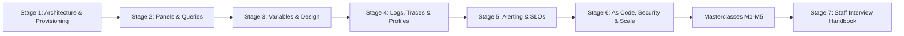

| Stage | Focus Domain | Core Concepts & Engineering Outcomes |
| :--- | :--- | :--- |
| **Stage 1** | **Foundations: Architecture, Installation & Provisioning** | The `grafana server` process, the SQL store and unified storage, the `/api/ds/query` path, `grafana.ini` and `GF_*` overrides, YAML data source and dashboard provisioning, orgs, roles and service accounts. Outcome: a reproducible Grafana + Prometheus stack started with `docker compose up`. |
| **Stage 2** | **Panels, Queries & Transformations** | The dashboard JSON model, data frames, `$__interval` and `$__rate_interval`, max data points, time series, stat, bar gauge, heatmap and table panels, units, thresholds, overrides, value mappings, transformations, server-side expressions and SQL expressions, Explore and the Drilldown apps. Outcome: panels that are correct at every zoom level. |
| **Stage 3** | **Variables, Templating & Dashboard Design** | Query, custom, interval, data source, switch and filter variables, chained variables, format specifiers such as `${job:regex}`, repeating panels and rows, data links, annotations, library panels, RED and USE layouts, recording rules tested with `promtool`. Outcome: one dashboard that serves every service and environment. |
| **Stage 4** | **Logs, Traces & Profiles** | Loki and LogQL, Tempo and TraceQL, Pyroscope, Grafana Alloy pipelines, exemplars, trace-to-logs and trace-to-metrics correlations. Outcome: jump from a latency spike to the exact trace and log line. |
| **Stage 5** | **Grafana Alerting & SLOs** | Alert rules, evaluation groups, contact points, notification policies, silences and mute timings, recording rules, multi-window burn-rate SLO alerts, alerting provisioning. Outcome: pages that fire on user impact, not on noise. |
| **Stage 6** | **Observability as Code, Security & Scale** | Terraform provider, Foundation SDK, Git Sync, RBAC, SSO and SCIM, the external database, HA, caching and capacity planning. Outcome: Grafana run as a multi-team platform with every change reviewed in Git. |
| **Masterclasses** | **Dynamic dashboards, Git Sync, alerting internals, plugins, LGTM blueprint** | Internals, complete worked builds, trade-off tables and production checklists for the newest and hardest parts of Grafana 13. |
| **Stage 7** | **Staff Interview Handbook** | 40+ interview Q&As across concepts, internals, architecture and live-incident scenarios, plus a one-page cheatsheet. |

### Language and format of the examples

Grafana is configured, not programmed, so the examples use the formats Grafana itself reads: **YAML** for provisioning, **dashboard JSON** for panels, **INI** for `grafana.ini`, **PromQL** for queries and **Prometheus rule files** for recording rules. The checks that keep those files honest are **Bash** scripts built on `jq`, `yq` and `promtool`, the tools Grafana and Prometheus operators already use. No general-purpose language is needed until plugin development in [M4](#m4-masterclass-plugin-development-with-typescript-and-go), where Grafana's own stack applies: TypeScript and React for the frontend, Go for the backend.

---

## 🆕 Grafana Versions, What's New & Migration

Grafana ships a major version roughly once a year and minor versions every one to three months. This guide targets **Grafana 13.x** (13.3 is the current stable release as of late 2026) with Prometheus 3.x.

### V.1 Release Timeline

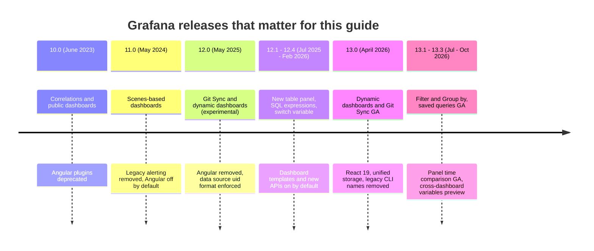

### V.2 Compatibility Matrix

| Grafana | Released | Dashboard model | Plugin frontend | Notable removals | Notes |
| --- | --- | --- | --- | --- | --- |
| 10.x | June 2023 | Classic JSON | React 18, Angular deprecated | None major | Public dashboards and correlations; service accounts are the recommended replacement for API keys |
| 11.x | May 2024 | Classic JSON rendered by Scenes | React 18, Angular disabled by default | Legacy alerting | Subfolders, Explore Metrics and Explore Logs (later renamed Drilldown) |
| 12.x | May 2025 | Classic JSON, v2 schema experimental | React 18, Angular removed | Angular, `editors_can_admin` | Data source uids must match `[a-zA-Z0-9_-]`, up to 40 characters |
| 13.x | April 2026 | Classic JSON and v2 schema (dynamic dashboards GA) | React 19 | `grafana-cli` and `grafana-server` binaries, Image Renderer plugin | Use 13.0.1 or later: 13.0.0 was withdrawn |

The starter pins `grafana/grafana:13.3.0` and `prom/prometheus:v3.15.1`. Pin exact tags in production too: a floating `latest` turns a routine restart into an unplanned major upgrade.

### V.3 What's New in Grafana 13

#### Dynamic dashboards are generally available

Dashboards can now mix layouts: a classic 24-column grid, an **auto grid** that sizes panels for you, **rows** and **tabs** that nest, **conditional rendering** that hides a panel or section when a variable has a given value or the panel has no data, and **variables scoped to a row or tab**. The new layout is stored in the **v2 dashboard schema**, served by the `dashboard.grafana.app` API group.

Before (classic, one flat grid, every panel positioned by hand):

```json
{
  "panels": [
    { "id": 5, "type": "timeseries", "gridPos": { "x": 0, "y": 4, "w": 12, "h": 8 } },
    { "id": 6, "type": "timeseries", "gridPos": { "x": 12, "y": 4, "w": 12, "h": 8 } }
  ]
}
```

After (v2 schema: panels live in `elements`, placement lives in `layout`, and tabs are a layout kind):

```json
{
  "elements": {
    "rps": { "kind": "Panel", "spec": { "title": "Requests per second" } },
    "p95": { "kind": "Panel", "spec": { "title": "p95 latency" } }
  },
  "layout": {
    "kind": "TabsLayout",
    "spec": {
      "tabs": [
        { "kind": "TabsLayoutTab", "spec": { "title": "Traffic",
          "layout": { "kind": "AutoGridLayout", "spec": { "items": [
            { "kind": "AutoGridLayoutItem", "spec": { "element": { "kind": "ElementReference", "name": "rps" } } },
            { "kind": "AutoGridLayoutItem", "spec": { "element": { "kind": "ElementReference", "name": "p95" } } }
          ] } } } }
      ]
    }
  }
}
```

The v2 example is trimmed to the layout keys (queries and field config omitted). Export a dashboard from Grafana 13 to see the full shape. Classic JSON keeps working, and this guide uses it for the starter because file provisioning, the linter in `examples/` and most existing tooling read it. [M1](#m1-masterclass-dynamic-dashboards-and-the-v2-schema) covers the v2 model in depth.

#### Git Sync is generally available

Git Sync connects a folder (or the whole instance) to a GitHub repository, with GitLab, Bitbucket and GitHub Enterprise support added during 13.x. Dashboards are saved as files in the repository; saving in the UI creates a commit or a pull request, and merged changes flow back into Grafana. It replaces the classic pattern of "file provisioning plus a CI job that copies JSON", which only syncs one way.

| | File provisioning (Stage 1) | Git Sync (M2) |
| --- | --- | --- |
| Direction | Disk to Grafana only | Both ways |
| UI edits | Blocked or lost on restart | Become commits or pull requests |
| Needs | A volume with JSON files | A Git provider connection and token |
| Good for | Immutable images, CI tests, air-gapped sites | Teams that edit in the UI but review in Git |

#### Saved queries, visualization suggestions and the new gauge

Queries can be saved to a shared library and reused across panels (GA in 13.2, with provisioning support). Visualization suggestions recommend a panel type based on the shape of the returned data. The gauge panel was rebuilt with a new look and options. These change the authoring workflow, not the JSON you provision.

#### Filter and Group by

Ad hoc filters were renamed **Filter and Group by** in 13.1 and gained grouping for Prometheus and Loki. In the dashboard JSON the variable is still `"type": "adhoc"` (classic) or `"kind": "AdhocVariable"` (v2), so existing dashboards keep working.

#### New `/apis` resource API

Grafana is moving its HTTP API to a Kubernetes-style layout: `/apis/<group>/<version>/namespaces/<namespace>/<resource>`. The legacy `/api/...` routes are deprecated in 13.0 but still served. New automation should use the resource API.

Before:

```bash
curl -s -u "admin:$GRAFANA_ADMIN_PASSWORD" \
  http://localhost:3000/api/dashboards/uid/learn-grafana-red | jq '.dashboard.title'
```

After:

```bash
curl -s -u "admin:$GRAFANA_ADMIN_PASSWORD" \
  http://localhost:3000/apis/dashboard.grafana.app/v1/namespaces/default/dashboards/learn-grafana-red \
  | jq '.spec.title'
```

`default` is the namespace of organization 1. List what your server serves with `curl -s localhost:3000/apis | jq '.groups[].name'` before you hard-code a version.

#### Grafana Advisor

Advisor (GA in 13.0) runs health checks against the instance itself: outdated or unsigned plugins, data sources that fail their health check, and configuration problems. It is the first page to open after an upgrade.

### V.4 Migration Guide (12.x → 13.x)

Upgrade to the latest 12.4 patch first, then to the latest 13.x patch. Skipping straight from 11 to 13 works in principle, but you then debug two sets of breaking changes at once.

```bash
# 0. Record what you run today.
curl -s http://localhost:3000/api/health | jq -r '.version'

# 1. Back up the database. The 13.0 unified-storage migration rewrites
#    dashboards and folders, and a downgrade needs this backup.
docker compose stop grafana
docker run --rm -v learn-grafana_grafana-data:/var/lib/grafana alpine:3.22 \
  sh -c 'apk add --no-cache sqlite >/dev/null &&
         sqlite3 /var/lib/grafana/grafana.db ".backup /var/lib/grafana/grafana-pre13.db"'
# PostgreSQL:  pg_dump --format=custom --file=grafana-pre13.dump "$GRAFANA_DB_URL"
# MySQL:       mysqldump --single-transaction grafana > grafana-pre13.sql

# 2. Update plugins while still on 12.x, so React 19 compatible versions are in place.
docker compose run --rm --entrypoint grafana grafana cli plugins update-all

# 3. Find automation that 13.0 breaks.
grep -rnE 'grafana-(cli|server)\b' deploy/ scripts/ systemd/ 2>/dev/null   # renamed to "grafana cli" / "grafana server"
grep -rnE '/api/datasources/[0-9]+' scripts/ 2>/dev/null                  # numeric-id data source APIs are disabled
grep -rnE 'grafana-image-renderer' deploy/ 2>/dev/null                    # renderer must run as a separate service

# 4. Bump the image tag (Dockerfile or compose.yaml), rebuild and start.
sed -i 's|grafana/grafana:12\.[0-9.]*|grafana/grafana:13.3.0|' Dockerfile
docker compose up -d --build grafana

# 5. Watch the one-time storage migration and look for errors.
docker compose logs -f grafana | grep -Ei 'unifiedstorage|migration|level=error'

# 6. Verify.
curl -s http://localhost:3000/api/health | jq -r '.version'
GRAFANA_PASSWORD="$GRAFANA_ADMIN_PASSWORD" bash examples/live/smoke.sh
```

If you run the Image Renderer, set `[rendering] renderer_token` to a non-default value and give the renderer service the same token: 13.0 switched renderer authentication to JWTs.

### V.5 Deprecations & Breaking Changes

| Version | Deprecated / removed | Replacement | What breaks and how to fix it |
| --- | --- | --- | --- |
| 11.0 | Legacy (dashboard) alerting removed | Grafana Alerting | Old alert definitions in panel JSON are ignored. Migrate rules before upgrading from 10.x. |
| 11.0 | Angular plugin support disabled by default | React plugins | Panels show "Angular deprecated". Replace the plugin. Core Angular panels such as Graph are migrated automatically to their React successors (Time series). |
| 12.0 | Angular removed entirely | React plugins | `angular_support_enabled` no longer helps. Any remaining Angular plugin stops loading. |
| 12.0 | Free-form data source uids | uids of `[a-zA-Z0-9_-]`, up to 40 characters | Provisioning and API calls with other uids are rejected. Create a new data source with a valid uid and repoint dashboards and alert rules. |
| 12.0 | `editors_can_admin` setting | Folder and team permissions | Editors lose the implicit admin rights on folders they created. Grant them explicitly. |
| 13.0 | `grafana-cli` and `grafana-server` binaries | `grafana cli`, `grafana server` | systemd units and entrypoints that call the old names fail to start. |
| 13.0 | Numeric-id data source APIs disabled | uid-based routes such as `/api/datasources/uid/:uid` | Scripts calling `/api/datasources/42` get errors. The `datasourceLegacyIdApi` feature toggle restores them temporarily. |
| 13.0 | Image Renderer as a plugin | Image Renderer as a separate service | Scheduled reports and alert screenshots stop rendering. Deploy `grafana/grafana-image-renderer` as its own container. |
| 13.0 | Legacy `/api` routes deprecated (still served) | `/apis/<group>/<version>/...` | Nothing breaks yet. Move new automation to `/apis`. |
| 13.0 | Legacy dashboard and folder tables | Unified storage | Downgrading after the migration shows stale data. Restore the pre-upgrade backup to roll back. |
| 13.0 | Several legacy Alertmanager config endpoints removed or admin-only | `notifications.alerting.grafana.app/v1beta1` resources | Tooling that tests receivers or deletes alert config through the old endpoints fails. |
| 13.x | Ad hoc filters renamed Filter and Group by | Same variable, new name | UI wording only. The JSON type stays `adhoc`. |

---

## 📋 Table of Contents

- [🆕 Grafana Versions, What's New & Migration](#-grafana-versions-whats-new--migration)
- [1. Stage 1: Foundations: Architecture, Installation & Provisioning](#1-stage-1-foundations-architecture-installation--provisioning)
  - [1.1 What Grafana Is, and What It Is Not](#11-what-grafana-is-and-what-it-is-not)
  - [1.2 Server Architecture](#12-server-architecture)
  - [1.3 How a Panel Query Travels](#13-how-a-panel-query-travels)
  - [1.4 Installation & First Run](#14-installation--first-run)
  - [1.5 Line-by-Line Breakdown of the Starter Project](#15-line-by-line-breakdown-of-the-starter-project)
  - [1.6 Configuration: `defaults.ini`, `grafana.ini` and `GF_*` Variables](#16-configuration-defaultsini-grafanaini-and-gf_-variables)
  - [1.7 Provisioning Data Sources](#17-provisioning-data-sources)
  - [1.8 Provisioning Dashboards](#18-provisioning-dashboards)
  - [1.9 Organizations, Folders, Roles and Service Accounts](#19-organizations-folders-roles-and-service-accounts)
  - [1.10 Talking to the HTTP API](#110-talking-to-the-http-api)
  - [1.11 Pitfalls](#111-pitfalls)
  - [1.12 Best Practices](#112-best-practices)
  - [1.13 Hands-on Exercise](#113-hands-on-exercise)
- [2. Stage 2: Panels, Queries & Transformations](#2-stage-2-panels-queries--transformations)
  - [2.1 The Dashboard JSON Model](#21-the-dashboard-json-model)
  - [2.2 Data Frames: What a Query Returns](#22-data-frames-what-a-query-returns)
  - [2.3 Query Options, `$__interval` and `$__rate_interval`](#23-query-options-__interval-and-__rate_interval)
  - [2.4 Choosing a Visualization](#24-choosing-a-visualization)
  - [2.5 Field Configuration: Units, Thresholds and Overrides](#25-field-configuration-units-thresholds-and-overrides)
  - [2.6 Stat, Gauge and Bar Gauge with Value Mappings](#26-stat-gauge-and-bar-gauge-with-value-mappings)
  - [2.7 Heatmaps and Histograms](#27-heatmaps-and-histograms)
  - [2.8 Tables and Transformations](#28-tables-and-transformations)
  - [2.9 Server-side Expressions and SQL Expressions](#29-server-side-expressions-and-sql-expressions)
  - [2.10 Explore and the Drilldown Apps](#210-explore-and-the-drilldown-apps)
  - [2.11 Pitfalls](#211-pitfalls)
  - [2.12 Best Practices](#212-best-practices)
  - [2.13 Hands-on Exercise](#213-hands-on-exercise)
- [3. Stage 3: Variables, Templating & Dashboard Design](#3-stage-3-variables-templating--dashboard-design)
  - [3.1 Variable Types](#31-variable-types)
  - [3.2 Interpolation and Format Specifiers](#32-interpolation-and-format-specifiers)
  - [3.3 Chained Variables and Refresh Cost](#33-chained-variables-and-refresh-cost)
  - [3.4 Repeating Panels and Rows](#34-repeating-panels-and-rows)
  - [3.5 Dashboard Links, Data Links and URL State](#35-dashboard-links-data-links-and-url-state)
  - [3.6 Annotations](#36-annotations)
  - [3.7 Library Panels, Templates and Reuse](#37-library-panels-templates-and-reuse)
  - [3.8 Dashboard Design Methods](#38-dashboard-design-methods)
  - [3.9 Recording Rules Behind the Dashboards](#39-recording-rules-behind-the-dashboards)
  - [3.10 Dashboards That Stay Fast and Correct](#310-dashboards-that-stay-fast-and-correct)
  - [3.11 Pitfalls](#311-pitfalls)
  - [3.12 Best Practices](#312-best-practices)
  - [3.13 Hands-on Exercise](#313-hands-on-exercise)
- [4. Stage 4: Logs, Traces & Profiles: Loki, Tempo, Pyroscope and Correlations](#4-stage-4-logs-traces--profiles-loki-tempo-pyroscope-and-correlations)
  - [4.1 Loki and LogQL](#41-loki-and-logql)
  - [4.2 Tempo and TraceQL](#42-tempo-and-traceql)
  - [4.3 Correlations: Exemplars, Derived Fields and Trace-to-Logs](#43-correlations-exemplars-derived-fields-and-trace-to-logs)
  - [4.4 Grafana Alloy](#44-grafana-alloy)
  - [4.5 Pitfalls](#45-pitfalls)
  - [4.6 Best Practices](#46-best-practices)
- [5. Stage 5: Grafana Alerting & SLOs](#5-stage-5-grafana-alerting--slos)
  - [5.1 Rule Evaluation and Alert States](#51-rule-evaluation-and-alert-states)
  - [5.2 Provisioning an Alert Rule](#52-provisioning-an-alert-rule)
  - [5.3 SLO Burn-rate Alerts](#53-slo-burn-rate-alerts)
  - [5.4 Pitfalls](#54-pitfalls)
  - [5.5 Best Practices](#55-best-practices)
- [6. Stage 6: Observability as Code, Security & Operating Grafana at Scale](#6-stage-6-observability-as-code-security--operating-grafana-at-scale)
  - [6.1 Choosing an Observability-as-Code Tool](#61-choosing-an-observability-as-code-tool)
  - [6.2 Security Model](#62-security-model)
  - [6.3 High Availability](#63-high-availability)
  - [6.4 Pitfalls](#64-pitfalls)
  - [6.5 Best Practices](#65-best-practices)
- [M1. Masterclass: Dynamic Dashboards and the v2 Schema](#m1-masterclass-dynamic-dashboards-and-the-v2-schema)
  - [M1.1 How It Works Internally](#m11-how-it-works-internally)
  - [M1.2 Production Checklist](#m12-production-checklist)
- [M2. Masterclass: Git Sync and GitOps for Grafana](#m2-masterclass-git-sync-and-gitops-for-grafana)
  - [M2.1 How It Works Internally](#m21-how-it-works-internally)
  - [M2.2 Production Checklist](#m22-production-checklist)
- [M3. Masterclass: Alerting Internals and High Availability](#m3-masterclass-alerting-internals-and-high-availability)
  - [M3.1 How It Works Internally](#m31-how-it-works-internally)
  - [M3.2 Production Checklist](#m32-production-checklist)
- [M4. Masterclass: Plugin Development with TypeScript and Go](#m4-masterclass-plugin-development-with-typescript-and-go)
  - [M4.1 How It Works Internally](#m41-how-it-works-internally)
  - [M4.2 Production Checklist](#m42-production-checklist)
- [M5. Masterclass: Flagship Blueprint: an LGTM Observability Platform](#m5-masterclass-flagship-blueprint-an-lgtm-observability-platform)
  - [M5.1 Architecture](#m51-architecture)
  - [M5.2 Production Checklist](#m52-production-checklist)
- [7. Stage 7: Staff Grafana Observability Engineer Interview Handbook & Cheatsheet](#7-stage-7-staff-grafana-observability-engineer-interview-handbook--cheatsheet)
  - [7.1 Core Concepts (Q1-Q10)](#71-core-concepts-q1-q10)
  - [7.2 Staff Cheatsheet](#72-staff-cheatsheet)
- [🧪 Example Projects](#-example-projects)
- [📝 Cheat Sheets](#-cheat-sheets)
- [📚 Resources](#-resources)
- [🤝 Contributing](#-contributing)
- [📄 License](#-license)
- [🙏 Acknowledgments](#-acknowledgments)
- [🌐 Connect with me](#-connect-with-me)
- [☕ Support](#-support)

---

## 1. Stage 1: Foundations: Architecture, Installation & Provisioning

This stage explains what the Grafana server does between a browser click and a Prometheus query, then builds the starter stack: Grafana and Prometheus in Docker, configured entirely from files in Git. You need Docker with the Compose plugin and basic shell skills; no prior Grafana knowledge. At the end you can start a Grafana whose data sources, folders and dashboards come from YAML and JSON, and you can explain where each piece of state lives.

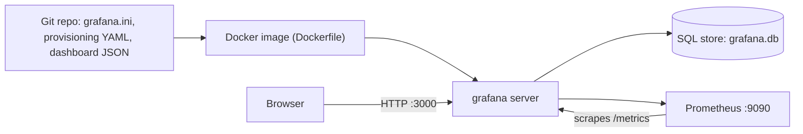

### 1.1 What Grafana Is, and What It Is Not

Grafana is a **query and visualization server**. It stores no metrics, logs or traces of its own. Every panel holds one or more queries written in the language of a **data source** (PromQL for Prometheus, LogQL for Loki, SQL for PostgreSQL, TraceQL for Tempo), and Grafana runs those queries on demand, then renders the results. What Grafana does store is small: dashboards, folders, users, teams, permissions, alert rules, annotations and data source definitions.

That design has consequences you will meet throughout the guide:

- **Dashboards are only as fast as the backend queries.** A slow panel is almost always a slow PromQL or SQL query, not a slow Grafana.
- **Retention is the data source's job.** If Prometheus keeps 15 days, a "last 90 days" panel shows 15 days of data and 75 days of nothing.
- **One Grafana can front many backends.** A single dashboard can show Prometheus metrics, Loki logs and a PostgreSQL business table side by side, and the Mixed data source lets one panel combine them.

| Tool | What it is | Stores data? | Query language | When to choose it over Grafana |
| --- | --- | --- | --- | --- |
| Grafana | Visualization, exploration and alerting front end | No (only config) | Whatever the data source speaks | Default choice when you have several backends |
| Prometheus web UI | Built-in expression browser | Yes (TSDB) | PromQL | Quick ad hoc checks of one Prometheus |
| Kibana / OpenSearch Dashboards | Front end tied to one search engine | Elasticsearch / OpenSearch | KQL, Lucene, ES\|QL, PPL | Log search is the main use and the cluster already exists |
| Datadog, New Relic and similar SaaS | Hosted agent, storage and UI in one product | Yes | Vendor specific | You want one vendor to run the whole pipeline |
| Perses | CNCF dashboard tool built for dashboards as code | No | PromQL-focused | You only need Prometheus dashboards defined as code |

The usual open-source pairing is the **LGTM stack**: **L**oki for logs, **G**rafana for the UI, **T**empo for traces and **M**imir (or plain Prometheus) for metrics, often with Pyroscope for profiles and Grafana Alloy as the collector. Stage 4 covers the backends; Stages 1-3 use Prometheus only.

### 1.2 Server Architecture

Grafana is one Go binary. `grafana server` starts the HTTP server, and `grafana cli` manages plugins and admin tasks (the separate `grafana-server` and `grafana-cli` binaries were removed in 13.0). Inside the server process:

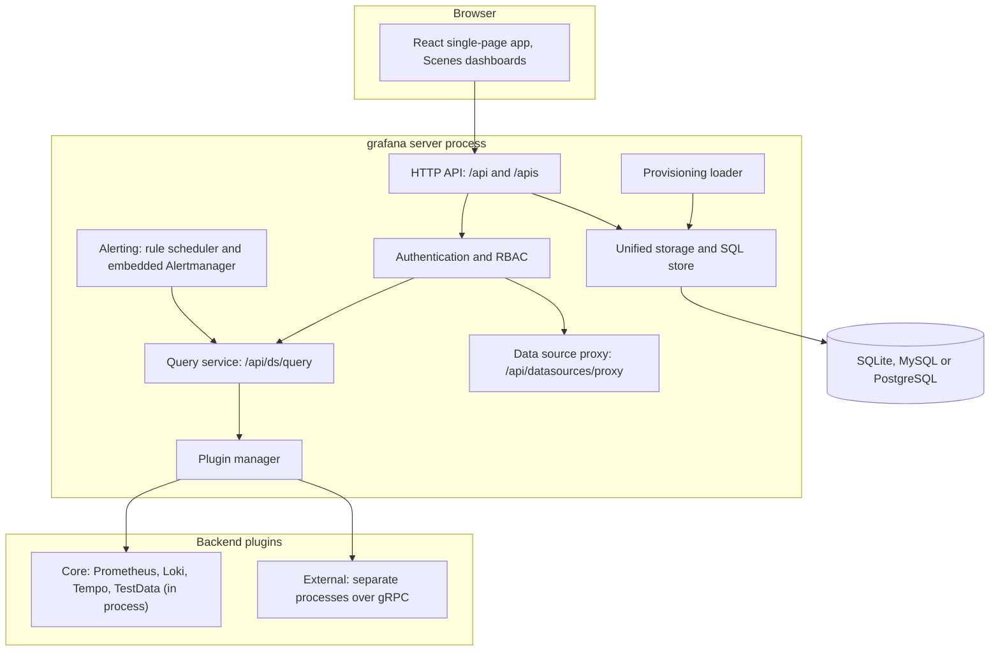

| Component | Responsibility | Where its state lives |
| --- | --- | --- |
| HTTP API | Serves the frontend bundle and the JSON APIs. `/api/...` is the legacy API; `/apis/<group>/<version>/...` is the Kubernetes-style resource API | Stateless |
| Authentication and RBAC | Sessions, basic auth, OAuth/SAML/LDAP, service account tokens, then a permission check on every request | Sessions and users in the SQL store |
| Query service | Receives panel queries at `/api/ds/query`, resolves the data source by uid, checks `datasources:query` permission and calls the plugin | Stateless |
| Data source proxy | Forwards raw HTTP calls for frontend-only plugins and injects stored credentials | Stateless |
| Plugin manager | Loads, verifies signatures of, and talks to backend plugins. External plugins run as child processes and speak gRPC | Plugin files in `/var/lib/grafana/plugins` |
| Alerting | Evaluates Grafana-managed rules on a schedule and routes notifications through an embedded Alertmanager | Rules and notification state in the SQL store |
| Provisioning loader | Reads `provisioning/` YAML at startup, and re-reads dashboard folders on an interval | Writes into the SQL store |
| Unified storage | Stores dashboards and folders as versioned resources (13.0 migrated them out of the legacy tables) | Resource tables in the same SQL database |

The SQL store is the only stateful dependency. SQLite (`/var/lib/grafana/grafana.db`) is the default and is fine for a single instance. Running two or more Grafana replicas requires a shared MySQL or PostgreSQL database, covered in Stage 6.

### 1.3 How a Panel Query Travels

When a dashboard loads, the frontend fetches the dashboard JSON, then sends each panel's queries to the backend. The backend never sends raw Prometheus JSON to the browser; it converts every result into **data frames**, the column-oriented format all panels consume.

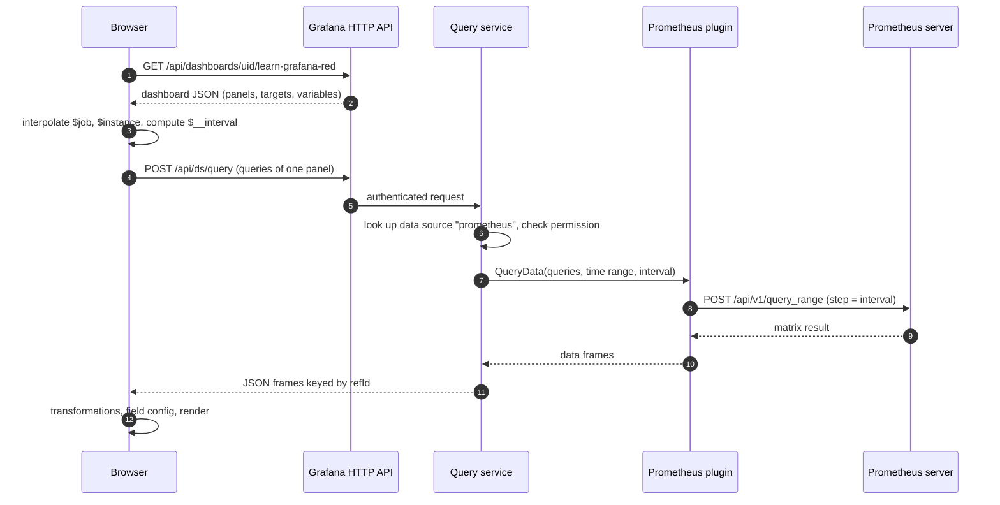

Three details matter in practice:

1. **Variables are interpolated in the browser** before the request leaves (step 3). Alert rules have no browser, which is why alert queries cannot use dashboard variables.
2. **The interval is computed per panel** from the time range, the panel width (max data points) and the data source's minimum interval. Stage 2 explains the formula.
3. **Credentials never reach the browser.** The plugin adds the stored token or password server-side, so viewers can query a data source they cannot see the credentials of.

You can replay step 4 with `curl`, which is the fastest way to tell a broken query from a broken panel:

```bash
curl -s -u "admin:$GRAFANA_ADMIN_PASSWORD" -H 'Content-Type: application/json' \
  -X POST http://localhost:3000/api/ds/query -d '{
    "from": "now-5m", "to": "now",
    "queries": [{
      "refId": "A",
      "datasource": { "uid": "prometheus" },
      "expr": "sum(job:http_requests:rate5m)",
      "instant": true, "range": false
    }]
  }' | jq '.results.A.frames[0].data.values'
```

### 1.4 Installation & First Run

The starter runs Grafana from its official image. Other options install the same binary.

| Method | Command | Good for |
| --- | --- | --- |
| Docker (this guide) | `docker run -d -p 3000:3000 grafana/grafana:13.3.0` | Labs, CI, Kubernetes |
| Docker Compose (starter) | `docker compose up --build` | Grafana plus its data sources on one machine |
| Debian / Ubuntu | `apt-get install grafana` after adding the `https://apt.grafana.com` repository | Long-lived VMs managed with systemd |
| RHEL / Fedora | `dnf install grafana` from `https://rpm.grafana.com` | Same, on RPM distributions |
| macOS | `brew install grafana` then `brew services start grafana` | Local experiments |
| Kubernetes | The `grafana/grafana` Helm chart, or the Grafana Operator | Clusters |
| Grafana Cloud | Hosted, nothing to install | Teams that do not want to run the stack |

Images come in several flavours. `grafana/grafana:<version>` is the Alpine-based OSS image the starter uses; `-ubuntu` variants exist for glibc-dependent plugins, and recent releases add `-distroless` variants with no shell. `grafana/grafana-enterprise` is the Enterprise build, which behaves like OSS until a licence is added.

Start the starter stack:

```bash
git clone https://github.com/TheLearningHubOrg/learn-grafana.git
cd learn-grafana
cp .env.example .env            # set GRAFANA_ADMIN_PASSWORD to something of your own
docker compose up --build -d
docker compose ps               # both services "running", prometheus "healthy"
curl -s http://localhost:3000/api/health
```

The health endpoint answers without authentication:

```json
{
  "database": "ok",
  "version": "13.3.0",
  "commit": "6f8ce3c693b493043ebcd4787566d2b6b118b0f0"
}
```

Open `http://localhost:3000`. Anonymous visitors land on the RED dashboard as Viewers; sign in as `admin` with the password from `.env` to edit. On a fresh Grafana without the starter's settings, the default login is `admin` / `admin` and Grafana forces a password change on first sign-in.

### 1.5 Line-by-Line Breakdown of the Starter Project

```text
learn-grafana/
├── compose.yaml                      Grafana + Prometheus for local use
├── Dockerfile                        validate stage + grafana/grafana runtime
├── grafana/
│   ├── grafana.ini                   overrides on top of defaults.ini
│   ├── provisioning/
│   │   ├── datasources/datasources.yaml
│   │   └── dashboards/dashboards.yaml
│   └── dashboards/
│       ├── platform/service-overview.json         RED dashboard (Stages 2-3)
│       └── sandbox/transformations-playground.json TestData playground (Stage 2)
├── prometheus/
│   ├── prometheus.yml                scrapes Prometheus and Grafana
│   ├── rules/red.rules.yml           recording rules the dashboards query
│   └── tests/red.rules.test.yml      promtool unit tests
├── examples/                         self-asserting checks (bash examples/run-all.sh)
└── solutions/                        answers to the hands-on exercises
```

The compose file:

```yaml
name: learn-grafana

services:
  grafana:
    build: .
    image: learn-grafana:local
    environment:
      GF_SECURITY_ADMIN_PASSWORD: ${GRAFANA_ADMIN_PASSWORD:?set GRAFANA_ADMIN_PASSWORD in .env}
    ports:
      - "3000:3000"
    volumes:
      - ./grafana/dashboards:/etc/grafana/dashboards:ro
      - grafana-data:/var/lib/grafana
    depends_on:
      prometheus:
        condition: service_healthy

  prometheus:
    image: prom/prometheus:v3.15.1
    command:
      - --config.file=/etc/prometheus/prometheus.yml
      - --storage.tsdb.path=/prometheus
      - --storage.tsdb.retention.time=2d
      - --web.enable-lifecycle
    ports:
      - "9090:9090"
    volumes:
      - ./prometheus:/etc/prometheus:ro
      - prometheus-data:/prometheus
    healthcheck:
      test: ["CMD", "wget", "-qO-", "http://localhost:9090/-/ready"]
      interval: 5s
      timeout: 3s
      retries: 20

volumes:
  grafana-data:
  prometheus-data:
```

| Line / API | Role | What happens at runtime |
| :--- | :--- | :--- |
| `build: .` | Builds the repo's Dockerfile | The validate stage lints every dashboard and runs the promtool tests; a broken dashboard fails `docker compose up --build` |
| `GF_SECURITY_ADMIN_PASSWORD: ${...:?...}` | Admin password from `.env` | Compose refuses to start when the variable is missing, so no stack runs with a guessable password |
| `./grafana/dashboards:/etc/grafana/dashboards:ro` | Live-mounts the dashboard JSON | The provider rescans every 30 s, so editing a JSON file updates Grafana without a rebuild |
| `grafana-data:/var/lib/grafana` | Named volume for the SQLite DB and plugins | Users, sessions, annotations and dashboard versions survive `docker compose down` (but not `down -v`) |
| `condition: service_healthy` | Start order | Grafana starts only after Prometheus answers `/-/ready`, so the first dashboard load has data |
| `--storage.tsdb.retention.time=2d` | Prometheus retention | Data older than two days is deleted; dashboards over longer ranges show gaps |
| `--web.enable-lifecycle` | Enables `POST /-/reload` | `curl -X POST localhost:9090/-/reload` reloads edited rules without a restart |
| `./prometheus:/etc/prometheus:ro` | Config and rules | The same files the promtool tests checked are the ones Prometheus loads |

And the Dockerfile that builds the Grafana image:

```dockerfile
FROM prom/prometheus:v3.15.1 AS promtool

FROM koalaman/shellcheck-alpine:stable AS lint
WORKDIR /src
COPY examples ./examples
RUN find examples -name '*.sh' -print0 | xargs -0 -r shellcheck -x --severity=warning

FROM alpine:3.22 AS validate
RUN apk add --no-cache bash coreutils findutils grep gawk jq yq-go
COPY --from=promtool /bin/promtool /usr/local/bin/promtool
WORKDIR /src
COPY compose.yaml ./
COPY prometheus ./prometheus
COPY grafana ./grafana
COPY --from=lint /src/examples ./examples
RUN bash examples/run-all.sh

FROM grafana/grafana:13.3.0 AS runtime
COPY --from=validate --chown=472:0 /src/grafana/grafana.ini /etc/grafana/grafana.ini
COPY --from=validate --chown=472:0 /src/grafana/provisioning /etc/grafana/provisioning
COPY --from=validate --chown=472:0 /src/grafana/dashboards /etc/grafana/dashboards
USER 472
EXPOSE 3000
HEALTHCHECK --interval=15s --timeout=5s --start-period=30s --retries=3 \
  CMD wget -qO- http://127.0.0.1:3000/api/health >/dev/null || exit 1
```

| Line / API | Role | What happens at runtime |
| :--- | :--- | :--- |
| `FROM prom/prometheus... AS promtool` | Source of the `promtool` binary | Nothing runs; the stage only exists so `COPY --from=promtool` can take a statically linked binary |
| `RUN bash examples/run-all.sh` | Tests as a build gate | A failing check stops the build, so a published image always holds valid dashboards |
| `COPY --from=validate ...` | Copies the files that passed | The runtime stage depends on `validate`, which forces BuildKit to run it (unused stages are skipped) |
| `--chown=472:0` | Ownership | UID 472 is the `grafana` user in the official image; files stay readable after `USER 472` |
| `EXPOSE 3000` | Documents the port | Must match `http_port` in `grafana.ini` and `APP_PORT` in `.github/workflows/ci.yml` |
| `HEALTHCHECK ... /api/health` | Container health | `/api/health` checks the database connection, so "healthy" means Grafana can read its store |

### 1.6 Configuration: `defaults.ini`, `grafana.ini` and `GF_*` Variables

Grafana reads settings in layers. Later layers win:

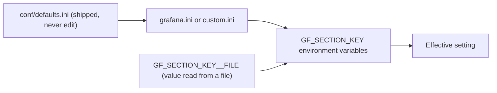

The environment variable name is `GF_`, the section name, an underscore and the key, all upper case, with dots and dashes in the section name turned into underscores:

| `grafana.ini` | Environment variable |
| --- | --- |
| `[server] root_url` | `GF_SERVER_ROOT_URL` |
| `[security] admin_password` | `GF_SECURITY_ADMIN_PASSWORD` |
| `[auth.anonymous] enabled` | `GF_AUTH_ANONYMOUS_ENABLED` |
| `[auth.generic_oauth] client_secret` | `GF_AUTH_GENERIC_OAUTH_CLIENT_SECRET` |
| `[database] url` | `GF_DATABASE_URL` |
| `[feature_toggles] enable` | `GF_FEATURE_TOGGLES_ENABLE` |

Two ways keep secrets out of files and process listings:

```ini
# grafana.ini: expand values at startup
[database]
type = postgres
host = $__env{GRAFANA_DB_HOST}
password = $__file{/run/secrets/grafana_db_password}
```

```bash
# Or the __FILE suffix on any GF_ variable (Docker and Kubernetes secrets)
docker run -d -p 3000:3000 \
  -v "$PWD/secrets:/run/secrets:ro" \
  -e GF_SECURITY_ADMIN_PASSWORD__FILE=/run/secrets/admin_password \
  grafana/grafana:13.3.0
```

The starter's `grafana.ini` sets only what differs from the defaults:

```ini
[server]
http_addr = 0.0.0.0
http_port = 3000
enable_gzip = true

[security]
disable_gravatar = true
allow_embedding = false
x_xss_protection = false

[users]
allow_sign_up = false
default_theme = system

[auth.anonymous]
enabled = true
org_name = Main Org.
org_role = Viewer

[analytics]
reporting_enabled = false
check_for_updates = false
check_for_plugin_updates = false

[dashboards]
default_home_dashboard_path = /etc/grafana/dashboards/platform/service-overview.json
versions_to_keep = 20

[log]
mode = console
level = info

[metrics]
enabled = true
```

| Setting | Why it is set |
| --- | --- |
| `http_addr = 0.0.0.0` | Inside a container, `127.0.0.1` would make Grafana unreachable through the published port |
| `allow_embedding = false` | Sends `X-Frame-Options: deny` so other sites cannot frame Grafana (clickjacking) |
| `x_xss_protection = false` | The header is obsolete; Grafana 13 logs a deprecation warning while it is enabled |
| `[auth.anonymous] org_role = Viewer` | Lab convenience. Never give anonymous users Editor; turn anonymous access off on shared instances |
| `check_for_updates = false` | No outbound calls to grafana.com, useful behind firewalls and in CI |
| `default_home_dashboard_path` | The home page shows a real dashboard instead of the getting-started panel |
| `versions_to_keep = 20` | Each save keeps a version you can diff and restore from the dashboard settings |
| `[metrics] enabled = true` | Serves `/metrics`, which the `grafana` scrape job reads; the dashboards monitor Grafana itself |

Inspect the effective configuration as a Server Admin under **Administration > General > Settings**, or with `GET /api/admin/settings`. Secrets show as `*********`.

### 1.7 Provisioning Data Sources

Provisioning turns click-ops into files. On startup Grafana reads every YAML file under `provisioning/datasources/`, creates missing data sources and updates existing ones, matching them by `name` and `orgId`. The starter's file:

```yaml
apiVersion: 1

datasources:
  - name: Prometheus
    type: prometheus
    uid: prometheus
    access: proxy
    url: http://prometheus:9090
    isDefault: true
    editable: false
    jsonData:
      timeInterval: 15s
      httpMethod: POST
      prometheusType: Prometheus

  - name: TestData
    type: grafana-testdata-datasource
    uid: testdata
    editable: false
```

| Key | Meaning | Pitfall it prevents |
| --- | --- | --- |
| `uid` | Stable identifier that dashboards and alert rules reference | Without it Grafana generates a random uid per instance, and dashboards exported from one Grafana break on another |
| `type` | Plugin id: `prometheus`, `loki`, `tempo`, `grafana-postgresql-datasource`, `grafana-testdata-datasource` | Old ids such as `testdata` or `postgres` are aliases at best; use the id shown on the plugin page |
| `access: proxy` | Grafana's backend makes the request | `direct` (browser access) is deprecated and leaks the URL and credentials to the browser |
| `url: http://prometheus:9090` | Address as seen from the Grafana process | `localhost` inside a container points at the container itself |
| `isDefault` | Data source for new panels | Two defaults in one org stop provisioning with an error |
| `editable: false` | Locks the definition in the UI | Prevents a hand edit that the next restart silently reverts |
| `jsonData.timeInterval` | Scrape interval, used as the minimum step and for `$__rate_interval` | A mismatch with Prometheus' `scrape_interval` makes `rate()` panels gappy |
| `jsonData.httpMethod: POST` | Sends PromQL in the body | Long queries with many variable values exceed URL length limits with GET |
| `secureJsonData` (not used here) | Passwords, tokens, TLS keys; encrypted in the database | Values in `jsonData` are stored in plain text and returned by the API |

Credentials for a real backend use environment variable expansion, so the YAML can live in Git:

```yaml
apiVersion: 1

datasources:
  - name: Mimir
    type: prometheus
    uid: mimir-prod
    access: proxy
    url: https://mimir.example.internal/prometheus
    basicAuth: true
    basicAuthUser: grafana-reader
    jsonData:
      timeInterval: 30s
      httpHeaderName1: X-Scope-OrgID
    secureJsonData:
      basicAuthPassword: ${MIMIR_READER_PASSWORD}
      httpHeaderValue1: ${MIMIR_TENANT}
```

To remove a data source that was provisioned earlier, list it under `deleteDatasources` (deleting it from the `datasources` list alone leaves it in the database):

```yaml
apiVersion: 1

deleteDatasources:
  - name: Old Prometheus
    orgId: 1
```

Provisioning errors stop Grafana from finishing startup, and the log says exactly why. Two real examples from Grafana 13:

```text
level=error msg="Failed to provision data sources" error="Datasource provisioning error: datasource.yaml config is invalid. Only one datasource per organization can be marked as default"
level=error msg="Failed to provision data sources" error="Datasource provisioning error: [datasource.uidInvalid] invalid UID for datasource A: invalid format of UID. Only letters, numbers, '-' and '_' are allowed"
```

`examples/02-provisioning/provisioning.sh` catches both mistakes before Grafana ever starts.

### 1.8 Provisioning Dashboards

A **dashboard provider** points Grafana at a directory of JSON files:

```yaml
apiVersion: 1

providers:
  - name: learn-grafana
    orgId: 1
    type: file
    disableDeletion: true
    allowUiUpdates: false
    updateIntervalSeconds: 30
    options:
      path: /etc/grafana/dashboards
      foldersFromFilesStructure: true
```

| Option | Effect |
| --- | --- |
| `options.path` | Directory scanned recursively for `*.json` |
| `foldersFromFilesStructure: true` | Each sub-directory becomes a folder of the same name: `platform/` and `sandbox/` here. Cannot be combined with `folder` |
| `folder` / `folderUid` | Put every dashboard of this provider into one fixed folder instead |
| `updateIntervalSeconds` | How often the directory is rescanned for changed files (default 10) |
| `allowUiUpdates: false` | Saving in the UI fails with `Cannot save provisioned dashboard`; users can still export the JSON |
| `allowUiUpdates: true` | UI saves are stored in the database, but the next change to the file overwrites them |
| `disableDeletion: true` | Deleting the file does not delete the dashboard, and the UI cannot delete it either |

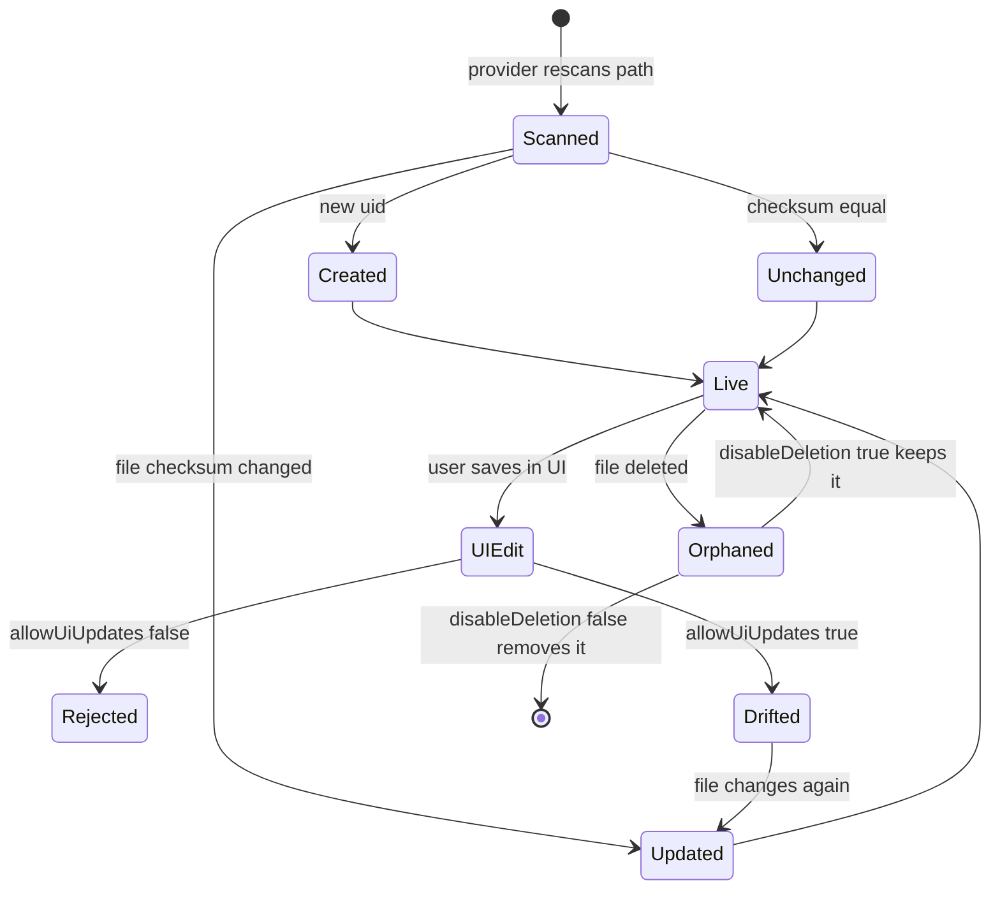

Rules for a provisioned dashboard file:

- **`"id": null`** (or no `id` at all). The numeric id belongs to one database; carrying it between instances causes conflicts.
- **A fixed `uid`** of up to 40 characters from `[a-zA-Z0-9_-]`. The uid is the URL (`/d/learn-grafana-red`) and the key Git Sync, Terraform and the API use.
- **Data sources referenced by uid or by the `${datasource}` variable**, never by name.
- **Exported "for sharing externally" JSON is for import, not provisioning.** That export replaces data source references with `${DS_PROMETHEUS}` inputs that only the import dialog resolves.

Grafana 13 records the origin of every provisioned dashboard on the resource itself. Through the new API:

```bash
curl -s -u "admin:$GRAFANA_ADMIN_PASSWORD" \
  http://localhost:3000/apis/dashboard.grafana.app/v1/namespaces/default/dashboards/learn-grafana-red \
  | jq '.metadata.annotations'
```

```json
{
  "grafana.app/folder": "fg36dvjqeaewwc",
  "grafana.app/managedBy": "classic-file-provisioning",
  "grafana.app/managerId": "learn-grafana",
  "grafana.app/sourcePath": "/etc/grafana/dashboards/platform/service-overview.json"
}
```

(output trimmed; the folder uid is generated per instance). `managedBy` is how the UI knows to block saves, and it is also how Git Sync marks the dashboards it owns.

### 1.9 Organizations, Folders, Roles and Service Accounts

Grafana's access model has four layers:

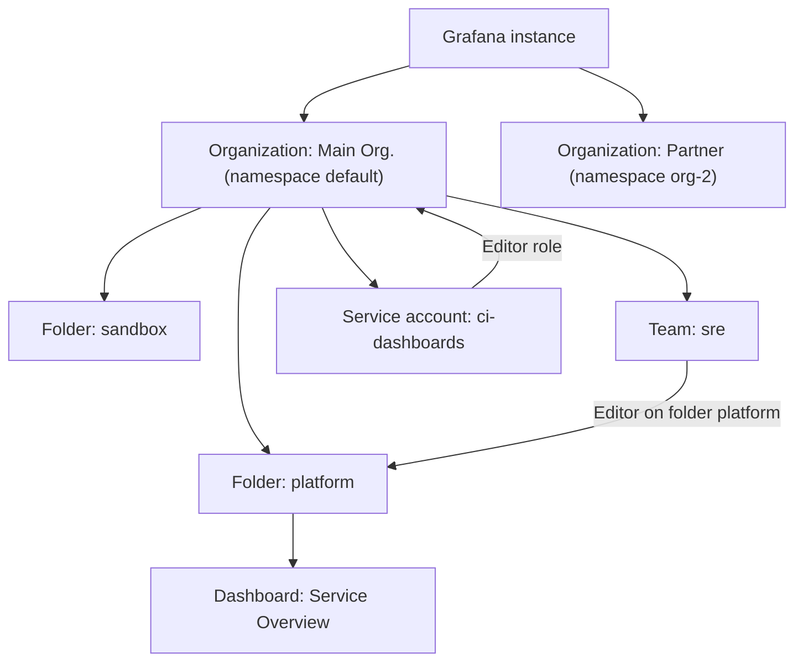

| Concept | What it scopes | Notes |
| --- | --- | --- |
| Organization | Everything: data sources, dashboards, users, alert rules | Hard isolation. Most companies use one org and folders, because cross-org sharing is clumsy |
| Folder | Dashboards, library panels, alert rules | Nested folders are supported. Permissions on a folder apply to everything inside |
| Basic role | Viewer, Editor, Admin, or No basic role, per org | Viewer can open dashboards and run their queries; Editor can create and edit; Admin manages the org |
| Grafana Server Admin | The whole instance | Separate flag for instance-wide tasks such as creating orgs |
| Team | A group of users | Grant folder permissions to teams, not individuals |
| Service account | A non-human identity with tokens | Replaces the old API keys. Tokens start with `glsa_` and can expire |
| RBAC fixed and custom roles | Fine-grained actions such as `dashboards:write` or `datasources:query` | Fixed roles exist in OSS; custom roles need Enterprise or Cloud |

Create a service account and a short-lived token for automation:

```bash
SA_ID=$(curl -s -u "admin:$GRAFANA_ADMIN_PASSWORD" -H 'Content-Type: application/json' \
  -X POST http://localhost:3000/api/serviceaccounts \
  -d '{"name": "ci-dashboards", "role": "Editor"}' | jq -r '.id')

TOKEN=$(curl -s -u "admin:$GRAFANA_ADMIN_PASSWORD" -H 'Content-Type: application/json' \
  -X POST "http://localhost:3000/api/serviceaccounts/${SA_ID}/tokens" \
  -d '{"name": "ci", "secondsToLive": 86400}' | jq -r '.key')

curl -s -H "Authorization: Bearer $TOKEN" 'http://localhost:3000/api/search?type=dash-db' | jq -r '.[].title'
```

The token is shown once. Store it in your CI secret store; Grafana keeps only a hash.

### 1.10 Talking to the HTTP API

Everything in the UI is available over HTTP. The calls below cover most day-one automation:

| Task | Request |
| --- | --- |
| Liveness and DB check | `GET /api/health` (no auth) |
| Find dashboards by tag | `GET /api/search?type=dash-db&tag=learn-grafana` |
| Read a dashboard (legacy) | `GET /api/dashboards/uid/{uid}` |
| Read a dashboard (resource API) | `GET /apis/dashboard.grafana.app/v1/namespaces/default/dashboards/{uid}` |
| Same dashboard in the v2 schema | `GET /apis/dashboard.grafana.app/v2/namespaces/default/dashboards/{uid}` |
| Run panel queries | `POST /api/ds/query` |
| Read a data source | `GET /api/datasources/uid/{uid}` |
| Add an annotation (deploy marker) | `POST /api/annotations` |
| List the API groups this server serves | `GET /apis` |

The resource API returns Kubernetes-shaped objects (`apiVersion`, `kind`, `metadata`, `spec`). The same dashboard can be read in the classic `v1` shape or converted on the fly to `v2`, which is a quick way to learn the new schema from a dashboard you already know:

```bash
curl -s -u "admin:$GRAFANA_ADMIN_PASSWORD" http://localhost:3000/apis \
  | jq -r '.groups[] | select(.name | test("dashboard|folder|alerting")) | "\(.name)  \([.versions[].version] | join(", "))"'
```

```text
dashboard.grafana.app  v2, v2beta1, v2alpha1, v0alpha1, v1, v1beta1
folder.grafana.app  v1, v1beta1
rules.alerting.grafana.app  v1beta1, v0alpha1
notifications.alerting.grafana.app  v1beta1, v0alpha1
```

That is the output of the starter on 13.3.0. Alpha and beta versions can change between minor releases; automate against `v1` (or `v2` for dynamic dashboards) where it exists.

### 1.11 Pitfalls

| Pitfall | Symptom | Fix |
| --- | --- | --- |
| Data source URL uses `localhost` inside Docker | Panel error `Post "http://localhost:9090/api/v1/query_range": dial tcp 127.0.0.1:9090: connect: connection refused` | Use the service name (`http://prometheus:9090`) or the host address the Grafana process can reach |
| Grafana binds `127.0.0.1` in a container | `curl: (52) Empty reply from server` or connection reset on port 3000 | `http_addr = 0.0.0.0` (the image default; do not override it to localhost) |
| Two `isDefault: true` data sources | Grafana never becomes healthy; log shows `Only one datasource per organization can be marked as default` | Exactly one default per org; `examples/02-provisioning` asserts it |
| Data source uid with dots or spaces | `[datasource.uidInvalid] invalid UID for datasource ...` and provisioning stops | Use `[a-zA-Z0-9_-]`, at most 40 characters; create a new data source and repoint dashboards |
| Dashboard JSON exported "for sharing externally" and provisioned | Panels show `Datasource ${DS_PROMETHEUS} was not found` | Export without that option, or replace the inputs with a `${datasource}` variable |
| Provisioned dashboard carries an `id` from another instance | Dashboards overwrite each other or fail to save | Set `"id": null` in every provisioned file |
| Editing a provisioned dashboard in the UI | Save fails with `Cannot save provisioned dashboard`, or (with `allowUiUpdates: true`) the change disappears on the next file change | Change the JSON in Git, or move the team to Git Sync (M2) |
| Admin password in `grafana.ini` committed to Git | Credential leak; also ignored after first start, because the password is only applied when the admin user is created | Pass `GF_SECURITY_ADMIN_PASSWORD` (or `__FILE`) at runtime; reset later with `grafana cli admin reset-admin-password` |
| `docker compose down -v` | All users, annotations and dashboard versions are gone | Use `down` without `-v`, and back up `/var/lib/grafana` or the external DB |
| Using the removed `grafana-server` binary in a custom entrypoint | Container exits with `grafana-server: not found` on 13.x | Call `grafana server` |
| Air-gapped instance | Startup logs show attempts to install preinstalled apps such as `grafana-lokiexplore-app` | Pre-load the plugins into the image, or turn off automatic preinstallation in the `[plugins]` section |

### 1.12 Best Practices

- **Pin the Grafana image to an exact version**: upgrades then happen in a reviewed commit, not on a container restart.
- **Give every data source a hand-picked uid**: dashboards, alert rules and Terraform all key on it, and random uids differ per instance.
- **Keep secrets out of Git and out of `jsonData`**: use `secureJsonData` with `${ENV}` expansion or `__FILE` variables.
- **Treat provisioning files as code**: lint them in CI (`examples/`) so a typo fails a build instead of a startup.
- **Set `allowUiUpdates: false` for file-provisioned dashboards**: one source of truth avoids silent drift.
- **Run one organization with folders per team**: permissions stay manageable and cross-team dashboards remain possible.
- **Use service accounts with expiring tokens for automation**: a leaked token stops working on its own, and audit logs show which robot did what.
- **Monitor Grafana with Grafana**: scrape its `/metrics`; the starter's RED dashboard does exactly that.

### 1.13 Hands-on Exercise

Add a second Prometheus data source named `Prometheus (long-term)` with uid `prometheus-longterm`, pointing at the same server, without making it the default.

1. Edit `grafana/provisioning/datasources/datasources.yaml`.
2. Run the checks: `docker build --target validate .` (the lint now accepts the new uid automatically, because it reads the allowed uids from the provisioning file).
3. Restart: `docker compose up -d --build grafana`.
4. Verify:

```bash
curl -s -u "admin:$GRAFANA_ADMIN_PASSWORD" \
  http://localhost:3000/api/datasources/uid/prometheus-longterm | jq -r '.type, .isDefault'
```

Expected output:

```text
prometheus
false
```

Then open the RED dashboard and switch the **Data source** drop-down to the new entry: every panel follows, because the panels reference `${datasource}`. The solution is in [`solutions/stage-1/datasources.yaml`](solutions/stage-1/datasources.yaml).

[Back to top ⤴️](#-table-of-contents)

---

## 2. Stage 2: Panels, Queries & Transformations

A panel is a pipeline: queries produce data frames, transformations reshape them, field configuration decides units, colours and thresholds, and a visualization draws the result. This stage takes that pipeline apart using the two dashboards in `grafana/dashboards/`. Prerequisites: Stage 1's stack running, and enough PromQL to read `rate()` and `sum by`. Afterwards you can build panels that stay correct at every zoom level and explain exactly why a panel shows what it shows.

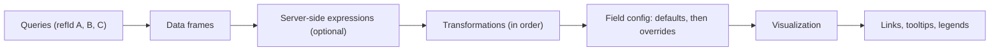

### 2.1 The Dashboard JSON Model

Every dashboard is a JSON document. Knowing its shape lets you review dashboards in pull requests, write linters, and fix problems the UI hides.

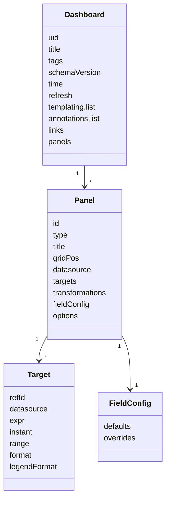

One panel from the starter, the error-ratio stat:

```json
{
  "id": 3,
  "type": "stat",
  "title": "Error ratio (worst job)",
  "gridPos": { "x": 12, "y": 0, "w": 6, "h": 4 },
  "datasource": { "type": "prometheus", "uid": "${datasource}" },
  "targets": [
    {
      "refId": "A",
      "datasource": { "type": "prometheus", "uid": "${datasource}" },
      "expr": "max(job:http_errors:ratio_rate5m{job=~\"$job\"})",
      "range": true,
      "instant": false
    }
  ],
  "fieldConfig": {
    "defaults": {
      "unit": "percentunit",
      "decimals": 2,
      "min": 0,
      "color": { "mode": "thresholds" },
      "thresholds": {
        "mode": "absolute",
        "steps": [
          { "color": "green", "value": null },
          { "color": "orange", "value": 0.01 },
          { "color": "red", "value": 0.05 }
        ]
      },
      "noValue": "0%"
    },
    "overrides": []
  },
  "options": {
    "reduceOptions": { "calcs": ["lastNotNull"], "fields": "", "values": false },
    "colorMode": "value",
    "graphMode": "area"
  }
}
```

| Key | Role | What happens at runtime |
| :--- | :--- | :--- |
| `id` | Panel id, unique within the dashboard | Used in URLs (`viewPanel=panel-3`) and by repeats; duplicates make panels overwrite each other |
| `gridPos` | Position on a 24-column grid, `h` in rows of about 30 px | `x + w` greater than 24 wraps unpredictably; the linter rejects it |
| `datasource.uid: "${datasource}"` | Data source chosen by the dashboard variable | Switching the variable re-runs every panel against another backend |
| `targets[].refId` | Name of the query | Transformations, expressions and overrides refer to queries by refId |
| `range: true` | Range query (`/api/v1/query_range`) | Returns a series over time; the stat reduces it with `lastNotNull` and draws the sparkline from it |
| `fieldConfig.defaults` | Settings applied to every field | Unit, thresholds and colour mode for the number |
| `thresholds.steps[0].value: null` | Base colour | The first step has no lower bound; it is the colour below the first real threshold |
| `noValue` | Text shown when the result is empty | Distinguishes "zero errors" from "query returned nothing" when you choose wording carefully |
| `options.reduceOptions.calcs` | How a series becomes one number | `lastNotNull`, `mean`, `max`, `sum` and others; choosing `mean` for a ratio averages ratios, which is usually wrong |

`schemaVersion` is the version of the classic JSON model (41 in the starter; Grafana 13 migrates older documents on load). Grafana stores the migrated form the next time the dashboard is saved, which is why a re-saved old dashboard produces a large diff.

### 2.2 Data Frames: What a Query Returns

Panels do not see Prometheus JSON. Each data source plugin returns **data frames**: tables of typed columns (fields), where a field can carry **labels**.

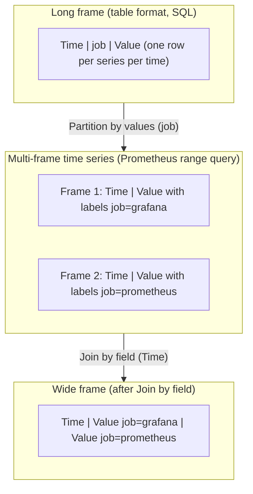

| Shape | Looks like | Produced by | Consumed best by |
| --- | --- | --- | --- |
| Multi-frame | One frame per series, labels on the value field | Prometheus and Loki range queries | Time series, stat, gauge |
| Wide | One time column, one value column per series | Join by field, many SQL queries with `GROUP BY time` pivoted | Time series, bar chart |
| Long | Time, label columns, one value column | SQL, Prometheus with `format: table` | Table, then Partition by values for graphs |
| Instant table | One row per series, no history | Prometheus instant query with `format: table` | Table, bar gauge |

When a panel looks wrong, open **Inspect > Data** (or press `i` over the panel) and switch on "Show data frame". Seeing the real frames ends most debugging sessions: the series you expected to be one frame is two, or a label you want in the legend is missing.

### 2.3 Query Options, `$__interval` and `$__rate_interval`

For range queries Grafana picks the **step** for you. The rules:

1. **Max data points** defaults to the panel width in pixels. A 600 px panel asks for at most about 600 points.
2. **Interval** = time range ÷ max data points, rounded to a tidy value (15s, 30s, 1m, 5m...), and never below the **min interval**: the panel's "Min interval" option, or else the data source's `timeInterval` (15 s in the starter).
3. `$__interval` is that interval. Prometheus range queries use it as `step`.
4. `$__rate_interval` = max(`$__interval` + scrape interval, 4 × scrape interval). It is the window to put inside `rate()`, `irate()` and `increase()`.

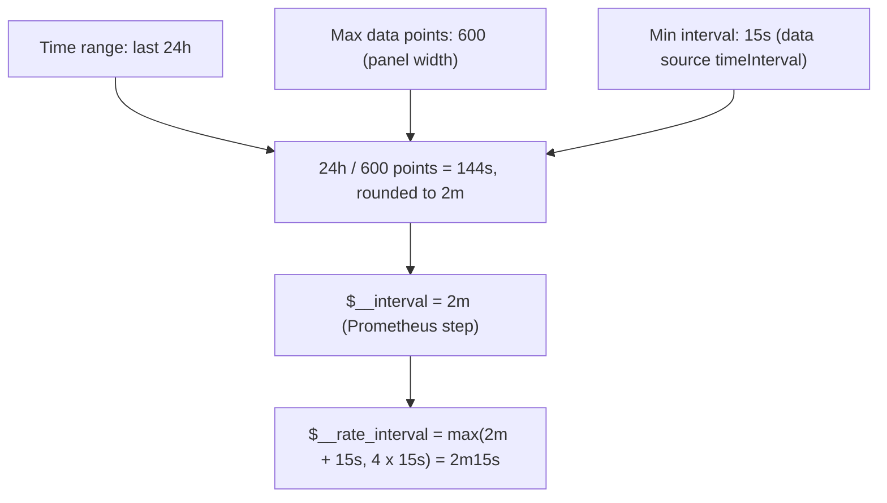

Why the fixed window fails: `rate(x[1m])` with a 2 m step evaluates one 1-minute window every 2 minutes, so half of all samples are never looked at. A spike between two steps disappears entirely. `rate(x[$__rate_interval])` always covers the whole step plus one scrape, and always includes at least four samples.

| Range | Panel width | `$__interval` | `rate(x[1m])` | `rate(x[$__rate_interval])` |
| --- | --- | --- | --- | --- |
| 1h | 600 px | 15s | Fine | `[1m]` |
| 24h | 600 px | 2m | Skips half the data | `[2m15s]` |
| 7d | 600 px | about 15m | Skips 93% of the data | about `[15m15s]` |
| 5m | 600 px | 15s (min interval) | Fine | `[1m]` (4 × scrape) |

The starter applies this rule in its one raw-rate panel, the latency heatmap:

```promql
sum by (le) (increase(grafana_http_request_duration_seconds_bucket{job="grafana", instance=~"$instance"}[$__rate_interval]))
```

and `examples/01-dashboard-lint/rules.jq` rejects any `rate()` or `increase()` with a fixed window. The other panels query recording rules (Stage 3.9), which have a fixed `[5m]` window by design: they are pre-computed at a steady 15 s rhythm, so they never skip samples.

Other query options per panel:

| Option | JSON | Use it for |
| --- | --- | --- |
| Min interval | `"interval": "1m"` | Data scraped more slowly than the data source default |
| Max data points | `"maxDataPoints": 300` | Cheaper queries on dense dashboards; bar charts that need fewer, wider bars |
| Relative time | `"timeFrom": "24h"` | A "last 24 h" panel that ignores the dashboard picker |
| Time shift | `"timeShift": "1w"` | Week-over-week comparison panels |
| Instant | `"instant": true, "range": false` | Stats, tables and bar gauges that need only the current value |
| Format | `"format": "table"` or `"heatmap"` | Table panels; heatmaps of classic histogram buckets |
| Legend | `"legendFormat": "{{job}} / {{instance}}"` | Readable series names from labels |

Grafana 13 also offers **time comparison** in the panel time settings (GA in 13.3), which overlays the same query shifted by a chosen period without a second query in the JSON.

### 2.4 Choosing a Visualization

Pick the panel from the question it answers and the shape of the data, not from looks.

| Question | Panel | Data shape | Starter example |
| --- | --- | --- | --- |
| How does this change over time? | Time series | Multi-frame or wide | Requests per second by job |
| What is the value now, is it OK? | Stat | Any; reduced to one number | Error ratio, p95 latency |
| How close to a limit? | Gauge, Bar gauge | One value per series, with min/max | Slowest handlers (Stage 2 exercise) |
| How are values distributed? | Heatmap, Histogram | Bucketed series or raw values | Grafana request latency distribution |
| Which items, with details? | Table | Instant table or long frame | Scrape targets |
| What state was it in, when? | State timeline, Status history | Series of discrete values | Deployment state per cluster |
| How do categories compare? | Bar chart | One row per category | Requests per service |
| Logs and traces | Logs, Traces | Loki, Tempo frames | Stage 4 |
| Free-form layout | Canvas, Text, Geomap, Node graph | Varies | Service maps, runbooks |

Two rules prevent most bad dashboards: **do not use a gauge for unbounded values** (requests per second has no meaningful maximum) and **do not use a pie chart for more than a handful of slices** (people compare lengths better than angles; use a bar gauge).

### 2.5 Field Configuration: Units, Thresholds and Overrides

Field config applies to every field a panel draws. `defaults` apply first, then each override, in order.

```json
"fieldConfig": {
  "defaults": {
    "unit": "s",
    "min": 0,
    "color": { "mode": "palette-classic" },
    "thresholds": {
      "mode": "absolute",
      "steps": [
        { "color": "transparent", "value": null },
        { "color": "red", "value": 1 }
      ]
    },
    "custom": {
      "drawStyle": "line",
      "lineWidth": 2,
      "fillOpacity": 0,
      "showPoints": "never",
      "thresholdsStyle": { "mode": "dashed" }
    }
  },
  "overrides": []
}
```

This is the "p95 latency by job" panel: series keep their palette colours, and the threshold at 1 s is drawn as a dashed red line rather than recolouring the series. The `transparent` base step means "no line below the first threshold".

Units do more than append a suffix: they scale. `bytes` shows 1.5 GiB instead of 1610612736, `s` shows 250 ms instead of 0.25, and `percentunit` expects 0..1 while `percent` expects 0..100. Picking `percent` for a ratio is a classic bug: 0.02 renders as "0.02%" instead of "2%".

| Data | Unit id | Note |
| --- | --- | --- |
| Ratio 0..1 | `percentunit` | Error ratios, SLO compliance |
| Percent 0..100 | `percent` | CPU % from node_exporter style expressions that already multiply by 100 |
| Seconds | `s` | Latency from Prometheus histograms (base unit is seconds) |
| Milliseconds | `ms` | Data that is already in ms |
| Bytes (IEC) | `bytes` | Memory; shows KiB, MiB, GiB |
| Bits per second | `bps` | Network throughput |
| Requests per second | `reqps` | Output of `rate()` on request counters |
| No unit | `none` | Counts; set it explicitly so the linter knows you chose it |

**Overrides** target fields by name, by regex, by type, by query refId or by a field value. The playground's random-walk panel draws the canary series dashed on a right-hand axis:

```json
"overrides": [
  {
    "matcher": { "id": "byRegexp", "options": "/canary/" },
    "properties": [
      { "id": "custom.lineStyle", "value": { "fill": "dash", "dash": [10, 10] } },
      { "id": "custom.axisPlacement", "value": "right" },
      { "id": "color", "value": { "mode": "fixed", "fixedColor": "purple" } }
    ]
  }
]
```

| Matcher id | Matches | Typical use |
| --- | --- | --- |
| `byName` | Exact display name | Unit for one table column |
| `byRegexp` | Regex on display name | All `canary` series, all `5xx` series |
| `byType` | Field type: `number`, `time`, `string` | Hide all string columns |
| `byFrameRefID` | Every field from query refId B | Second query on a right axis |
| `byValue` | Fields whose reduced value passes a condition | Highlight series whose max exceeds a limit |

Overrides apply in list order, and later ones win. When an override does not seem to apply, the display name usually differs from what you typed: legends built from `legendFormat` are display names, so `byName` must match `grafana`, not `job:http_requests:rate5m{job="grafana"}`.

### 2.6 Stat, Gauge and Bar Gauge with Value Mappings

These panels reduce each series to a single value with `reduceOptions.calcs`, then colour it with thresholds or mappings.

**Value mappings** replace numbers with text and colours. The playground's build-health stat:

```json
"mappings": [
  {
    "type": "value",
    "options": {
      "0": { "text": "FAILING", "color": "red", "index": 0 },
      "1": { "text": "PASSING", "color": "green", "index": 1 },
      "2": { "text": "FLAKY", "color": "orange", "index": 2 }
    }
  }
]
```

| Mapping type | JSON `type` | Example |
| --- | --- | --- |
| Value | `value` | `0` to `DOWN`, `1` to `UP` (the starter's table) |
| Range | `range` | `{ "from": 0, "to": 0.01, "result": { "text": "OK" } }` |
| Regex | `regex` | `{ "pattern": "^ip-(.*)\\.ec2.*", "result": { "text": "$1" } }` shortens host names |
| Special | `special` | `{ "match": "null", "result": { "text": "no data" } }`; also `nan`, `true`, `false`, `empty` |

Mappings win over thresholds for colour when both are set. A stat with `colorMode: "background"` and mappings gives a status tile; with `colorMode: "value"` and thresholds it gives a KPI.

`reduceOptions.values: false` (the default) reduces each series to one number. `values: true` shows one value per row instead, which is how a stat panel can display every row of a table result as its own tile.

### 2.7 Heatmaps and Histograms

A Prometheus classic histogram exposes cumulative buckets: `le="0.1"` counts requests that took at most 100 ms, `le="0.5"` those up to 500 ms (including the first bucket), and so on. The heatmap panel needs per-bucket counts, not cumulative ones. `format: "heatmap"` on the query does the conversion: it sorts frames by `le` and subtracts each bucket from the next.

```json
{
  "refId": "A",
  "expr": "sum by (le) (increase(grafana_http_request_duration_seconds_bucket{job=\"grafana\", instance=~\"$instance\"}[$__rate_interval]))",
  "format": "heatmap",
  "legendFormat": "{{le}}"
}
```

with panel options:

```json
"options": {
  "calculate": false,
  "yAxis": { "unit": "s", "axisPlacement": "left" },
  "color": { "mode": "scheme", "scheme": "Oranges", "scale": "exponential", "exponent": 0.5, "steps": 64 },
  "filterValues": { "le": 1e-9 },
  "tooltip": { "mode": "single", "yHistogram": true }
}
```

| Option | Why |
| --- | --- |
| `sum by (le)` | Keeps the bucket label and aggregates everything else away; without it each handler becomes its own set of buckets |
| `increase(...[$__rate_interval])` | Counts per cell, so the colour means "requests in this time slot" |
| `calculate: false` | The data is already bucketed; `true` is for raw values that Grafana should bucket itself |
| `scale: "exponential"` | Latency counts are skewed; a linear colour scale paints everything but the busiest bucket as empty |
| `filterValues.le: 1e-9` | Hides cells with no requests so empty space stays empty |

The heatmap shows what a p95 line hides: two clusters (fast cache hits and slow cold queries) produce one misleading percentile but two clear bands. Use percentiles for alerting and SLOs, heatmaps for diagnosis.

Prometheus **native histograms** store buckets in one series with exponential bucket boundaries. Grafana's heatmap renders them directly from `sum(rate(metric[$__rate_interval]))` without `format: heatmap`. Whether you can use them depends on how your Prometheus and client libraries are configured; the starter uses classic buckets because both Prometheus and Grafana expose them by default.

### 2.8 Tables and Transformations

Transformations run **in the browser, in list order**, after the queries return. Each one receives the frames the previous one produced. The starter's "Scrape targets" table joins three instant queries into one row per target:

```json
"targets": [
  { "refId": "A", "expr": "up{job=~\"$job\", instance=~\"$instance\"}", "format": "table", "instant": true },
  { "refId": "B", "expr": "process_resident_memory_bytes{job=~\"$job\", instance=~\"$instance\"}", "format": "table", "instant": true },
  { "refId": "C", "expr": "go_goroutines{job=~\"$job\", instance=~\"$instance\"}", "format": "table", "instant": true }
],
"transformations": [
  { "id": "merge", "options": {} },
  {
    "id": "organize",
    "options": {
      "excludeByName": { "Time": true, "__name__": true },
      "indexByName": { "job": 0, "instance": 1, "Value #A": 2, "Value #B": 3, "Value #C": 4 },
      "renameByName": { "job": "Job", "instance": "Instance", "Value #A": "State", "Value #B": "Memory", "Value #C": "Goroutines" }
    }
  }
]
```

| Step | Input | Output |
| --- | --- | --- |
| Queries | Three tables, each with `Time`, labels and `Value` | Columns `Value #A`, `Value #B`, `Value #C` (Grafana suffixes the refId) |
| `merge` | Three tables with the same label columns | One table, one row per `job`/`instance`, three value columns |
| `organize` | Merged table | `Time` and `__name__` hidden, columns reordered and renamed |
| Overrides | `State` and `Memory` columns | `State` mapped to UP/DOWN with a coloured background; `Memory` in bytes |

The playground shows why **order matters**. To get an error ratio per service from per-region rows, group first, then divide:

```json
"transformations": [
  {
    "id": "groupBy",
    "options": {
      "fields": {
        "service":  { "operation": "groupby",   "aggregations": [] },
        "requests": { "operation": "aggregate", "aggregations": ["sum"] },
        "errors":   { "operation": "aggregate", "aggregations": ["sum"] },
        "p95_ms":   { "operation": "aggregate", "aggregations": ["max"] }
      }
    }
  },
  {
    "id": "calculateField",
    "options": {
      "mode": "binary",
      "alias": "error ratio",
      "binary": { "left": "errors (sum)", "operator": "/", "right": "requests (sum)" }
    }
  },
  { "id": "sortBy", "options": { "sort": [{ "field": "error ratio", "desc": true }] } }
]
```

Reversing the first two steps computes a ratio per row and then cannot sum ratios meaningfully. The same trap exists in PromQL (`avg` of ratios versus ratio of sums), and it is the most common correctness bug in dashboards.

The transformations you will use most:

| Transformation | Id | Does |
| --- | --- | --- |
| Merge | `merge` | Combines table results that share label columns into one table |
| Join by field | `joinByField` | SQL-style join of frames on a field (default `Time`), inner or outer |
| Organize fields | `organize` | Hide, reorder, rename columns |
| Reduce | `reduce` | Series to rows: one row per series with Max, Mean, Last... |
| Filter data by values | `filterByValue` | Keep or drop rows by condition; the playground filters by `${region:regex}` |
| Filter fields by name | `filterFieldsByName` | Keep columns that match a regex |
| Calculate field | `calculateField` | Binary, reduce-row, unary, cumulative, window and row-index calculations |
| Group by | `groupBy` | SQL `GROUP BY` with aggregations |
| Partition by values | `partitionByValues` | Splits a long table into one frame per value, so a time series panel draws one line per group |
| Labels to fields | `labelsToFields` | Turns series labels into columns |
| Time series to table | `timeSeriesTable` | One row per series with a sparkline cell (GA in 13.1) |
| Sort by | `sortBy` | Sort rows by one or more fields (multi-field sort added in 13.3) |
| Config from query results | `configFromData` | Uses one query's result as thresholds or min/max for another |
| Regression analysis | `regression` | Fits a linear or polynomial trend line |

Because transformations run in each viewer's browser, they cost nothing on the server but everything on a laptop when the input is large. Aggregate in the query (PromQL `sum by`, SQL `GROUP BY`) and transform only what remains.

### 2.9 Server-side Expressions and SQL Expressions

**Expressions** are queries that run on the Grafana server, on the output of other queries. They use the pseudo data source `__expr__`, and they are the same engine alert rules use, which makes them the right tool when a calculation must behave identically in a panel and in an alert.

```json
"targets": [
  {
    "refId": "R",
    "datasource": { "uid": "prometheus" },
    "expr": "sum(job:http_requests:rate5m)",
    "range": true
  },
  {
    "refId": "RPM",
    "datasource": { "type": "__expr__", "uid": "__expr__" },
    "type": "math",
    "expression": "$R * 60"
  },
  {
    "refId": "PEAK",
    "datasource": { "type": "__expr__", "uid": "__expr__" },
    "type": "reduce",
    "expression": "R",
    "reducer": "max"
  }
]
```

| Type | Does | Notes |
| --- | --- | --- |
| `math` | Arithmetic across series and numbers: `$A / $B * 100` | Series are matched by labels. Math on an instant **table** result fails with `not implemented: binary * on mathexp.TableData and mathexp.Scalar`; use a range or instant series result |
| `reduce` | Series to one number per series: `max`, `mean`, `last`, `sum`, `count` | Mode `dropNN` or `replaceNN` decides what happens to NaN and null |
| `resample` | Aligns series to a common interval | Needed before math on series with different steps |
| `threshold` | Is the value above, below, inside or outside a range? | Used as the alert condition |
| `sql` | SQL over the results of other queries | See below |

**SQL expressions** treat each referenced query as a table and run a MySQL-dialect `SELECT` over it, which lets you join a Prometheus result with a PostgreSQL table, or compute things transformations make awkward. Prometheus results are converted to a long table with label columns and a `__value__` column:

```json
{
  "refId": "TOP",
  "datasource": { "type": "__expr__", "uid": "__expr__" },
  "type": "sql",
  "expression": "SELECT job, __value__ * 60 AS rpm FROM A ORDER BY rpm DESC"
}
```

Run against the starter with `A` = `job:http_requests:rate5m` (instant), this returns two columns, `job` and `rpm`, one row per job. Selecting `Value` instead of `__value__` fails with `[sse.sql.column_not_found] ... column "Value" could not be found`: check **Inspect > Data** for the real column names first. SQL expressions are on by default in Grafana 13.

| Need | Transformations | Expressions |
| --- | --- | --- |
| Runs where | Browser | Grafana server |
| Usable in alert rules | No | Yes |
| Cost on large results | Viewer's CPU and memory | Server CPU and memory, once per query |
| Cross-data-source joins | Join by field on matching values | SQL `JOIN` |
| Learning curve | Point and click | PromQL-like math, or SQL |

### 2.10 Explore and the Drilldown Apps

**Explore** (`/explore`) is the query workbench: no dashboard, one or two side-by-side panes, query history, and an **Add to dashboard** button once a query is right. Use it to develop a PromQL query before it goes into JSON, and to compare a metric with logs in a split pane.

The **Drilldown** apps (Metrics, Logs, Traces and Profiles Drilldown, previously Explore Metrics and Explore Logs) are queryless: you pick a metric or service and they generate breakdowns by every label for you. They answer "which label is different during the spike?" faster than hand-written queries. On self-managed Grafana these apps are plugins that Grafana preinstalls at startup, which needs internet access unless you bake them into the image.

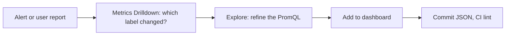

### 2.11 Pitfalls

| Pitfall | Symptom | Fix |
| --- | --- | --- |
| `rate(x[1m])` on long ranges | Spikes visible at 1 h vanish at 7 d; totals do not add up | `rate(x[$__rate_interval])`, or a recording rule |
| `percent` unit on a 0..1 ratio | "0.02%" where you expected "2%" | Use `percentunit` for 0..1 |
| Stat reduces with `mean` over a ratio | Number differs from the same ratio computed over the range in PromQL | Compute the ratio in the query; reduce with `lastNotNull` |
| Override by name does not apply | Column keeps the default unit | Match the **display name** shown in the legend or Inspect, or use `byFrameRefID` |
| Instant query feeding a time series panel | One dot, or "Data does not have a time field" | Use a range query, or a stat or table panel |
| Range query feeding a table | One row per timestamp, thousands of rows | Set `instant: true` and `format: table` |
| `merge` on queries with different label sets | Duplicate rows with empty cells | Aggregate queries to the same labels (`sum by (job, instance)`) before merging |
| Heatmap of cumulative buckets without `format: heatmap` | Top bucket is always the hottest; colours look inverted | Add `format: "heatmap"`, or let the panel calculate from raw data |
| Expressions math on a table result | `not implemented: binary * on mathexp.TableData and mathexp.Scalar` | Feed math a series (range or instant non-table) result |
| SQL expression selects `Value` | `[sse.sql.column_not_found]` | Use the converted column names, such as `__value__` for Prometheus |
| Panels refreshing faster than queries finish | Grafana log shows `context canceled` and panels flicker | Raise the dashboard refresh interval, speed up the query with recording rules |
| Legend shows `{__name__="...", instance="...", job="..."}` | Unreadable legend | Set `legendFormat` such as `{{job}}` |

### 2.12 Best Practices

- **Use `$__rate_interval` in every `rate()`, `irate()` and `increase()`**: it is the only window that is correct at every zoom level.
- **Set a unit on every numeric panel, even `none`**: a reviewer can then tell "forgot the unit" from "has no unit".
- **Reduce in the query, not in the browser**: `sum by` in PromQL ships kilobytes instead of megabytes to each viewer.
- **Prefer instant queries for stat, table and bar gauge panels that show only "now"**: they are cheaper and cannot be misread as an average.
- **Compute ratios as a ratio of sums**: `sum(errors) / sum(requests)`, never the mean of per-instance ratios.
- **Put thresholds where they mean something**: the same numbers as the alert or SLO, so a red panel and a page agree.
- **Use expressions for calculations that alerts must repeat**: one engine, one result.
- **Check Inspect > Data before changing options**: the frames tell you whether the problem is the query or the panel.

### 2.13 Hands-on Exercise

Add a **bar gauge** to the RED dashboard that shows the five slowest Grafana HTTP handlers by p95 latency, coloured green / orange / red at 0.25 s and 1 s.

Requirements:

- One instant query using `topk(5, histogram_quantile(0.95, sum by (handler, le) (rate(...[$__rate_interval]))))`.
- Unit `s`, horizontal orientation, legend from the `handler` label.
- `bash examples/run-all.sh` (or `docker build --target validate .`) still passes after you add the panel.

Expected result: up to five horizontal bars labelled with paths such as `/api/ds/query` and `/api/dashboards/uid/:uid`, each between a few milliseconds and a few hundred milliseconds on an idle lab. The solution panel is in [`solutions/stage-2/slowest-handlers-panel.json`](solutions/stage-2/slowest-handlers-panel.json); paste it into the `panels` array of `grafana/dashboards/platform/service-overview.json`.

[Back to top ⤴️](#-table-of-contents)

---

## 3. Stage 3: Variables, Templating & Dashboard Design

Variables turn one dashboard into many: the same RED layout serves every job, instance and environment. This stage covers every variable type, how Grafana interpolates values into queries, chained and repeated variables, links and annotations, and the design methods (RED, USE, drill-down hierarchies) that decide what goes on a dashboard at all. It ends with the recording rules behind the starter's panels and how to test them. Prerequisites: Stages 1 and 2. Afterwards you can design a dashboard family that a whole organization can navigate.

```mermaid
flowchart TB
    DS["$datasource (data source variable)"] --> JOB["$job: label_values(up, job)"]
    JOB --> INST["$instance: label_values(up{job=~\"$job\"}, instance)"]
    DS --> P["Panels: datasource uid = ${datasource}"]
    JOB --> P
    INST --> P
    P --> URL["URL: ?var-job=grafana&var-instance=grafana:3000"]
    URL --> Links["Dashboard and data links keep the selection"]
```

### 3.1 Variable Types

| Type | JSON `type` | Values come from | Starter / example |
| --- | --- | --- | --- |
| Query | `query` | A data source query: label values, metric names, SQL rows | `$job`, `$instance` |
| Custom | `custom` | A comma-separated list you type; `key : value` pairs allowed | `$region` in the playground |
| Text box | `textbox` | Free text the viewer types | A trace id or a customer id |
| Constant | `constant` | A hidden fixed value | A cluster name shared by every query in a provisioned copy |
| Data source | `datasource` | All data sources of one plugin type, optionally filtered by regex | `$datasource` |
| Interval | `interval` | A list of durations, optionally with an `auto` option | A user-chosen rollup window |
| Switch | `switch` | Two values, one for on and one for off (added in 12.3) | "Include canary instances" toggle |
| Filter and Group by | `adhoc` | Label keys and values from a data source, added to every query of that data source automatically | Ad hoc `namespace="checkout"` filtering; renamed from "Ad hoc filters" in 13.1 |
| Group by | `groupby` | Label keys; rewrites aggregations in supported data sources | Choosing `by (job)` or `by (instance)` at view time |

The starter's two Prometheus variables:

```json
{
  "name": "job",
  "label": "Job",
  "type": "query",
  "datasource": { "type": "prometheus", "uid": "${datasource}" },
  "definition": "label_values(up, job)",
  "query": "label_values(up, job)",
  "refresh": 2,
  "sort": 1,
  "multi": true,
  "includeAll": true,
  "allValue": ".+",
  "current": {}
},
{
  "name": "instance",
  "label": "Instance",
  "type": "query",
  "datasource": { "type": "prometheus", "uid": "${datasource}" },
  "definition": "label_values(up{job=~\"$job\"}, instance)",
  "query": "label_values(up{job=~\"$job\"}, instance)",
  "refresh": 2,
  "sort": 1,
  "multi": true,
  "includeAll": true,
  "allValue": ".+",
  "current": {}
}
```

| Key | Meaning |
| --- | --- |
| `query` | For Prometheus a string such as `label_values(...)` is accepted. The variable editor saves a structured object with a query type instead; both work |
| `refresh: 1` | Re-run the query when the dashboard loads |
| `refresh: 2` | Re-run it whenever the time range changes. Use this when the set of values depends on time (targets come and go) |
| `sort: 1` | Alphabetical ascending. `3` is numerical ascending, `7` is natural sort (case-insensitive and number-aware) |
| `multi: true` | Several values can be selected at once |
| `includeAll` / `allValue` | Adds "All"; `allValue` replaces the expanded list with a custom string (see 3.2) |
| `current: {}` | No stored selection; Grafana picks the first value or "All" on load |

The **Switch** variable is a cleaner replacement for "magic" custom variables with two values. Configure the on value as `.+` and the off value as `stable`, then filter with it:

```promql
sum by (job) (rate(http_requests_total{track=~"$include_canary"}[$__rate_interval]))
```

With the switch on, every track matches; off, only `track="stable"` does.

Prometheus query variables accept these functions:

| Function | Returns | Cost |
| --- | --- | --- |
| `label_names()` | All label names | Cheap (uses the labels API) |
| `label_values(label)` | Values of a label across all series | Can be expensive on large servers: no metric restricts it |
| `label_values(metric{matchers}, label)` | Values of a label on matching series | The default choice; always pass a metric and matchers |
| `metrics(regex)` | Metric names matching a regex | Medium |
| `query_result(promql)` | One value per result line of an instant query, as text | Needs a `regex` to extract the part you want |

The **Regex** field filters and rewrites results. With named groups you can show one thing and send another:

```text
/instance="(?<value>[^"]+)".*pod="(?<text>[^"]+)"/
```

applied to `query_result(up{job="api"})` shows pod names in the drop-down while queries receive instance addresses.

### 3.2 Interpolation and Format Specifiers

Grafana replaces `$var`, `${var}` and `${var:format}` before the query leaves the browser. With several values selected, the format decides how they are joined. Assume `$job` holds `grafana` and `prometheus`:

| Syntax | Result | Use with |
| --- | --- | --- |
| `$job` in a Prometheus query | `(grafana\|prometheus)` | Prometheus and Loki label matchers with `=~`; Grafana escapes regex characters for you |
| `${job:regex}` | `(grafana\|prometheus)` | Any field that expects a regex, such as the playground's filter transformation |
| `${job:csv}` | `grafana,prometheus` | APIs and SQL `IN` lists of numbers |
| `${job:pipe}` | `grafana\|prometheus` | Graphite, InfluxQL regex without parentheses |
| `${job:singlequote}` | `'grafana','prometheus'` | SQL `IN ('a','b')` |
| `${job:sqlstring}` | `'grafana','prometheus'` with quotes inside values doubled | SQL, safer than `singlequote` |
| `${job:json}` | `["grafana","prometheus"]` | JSON APIs, Infinity data source |
| `${job:queryparam}` | `var-job=grafana&var-job=prometheus` | Links to other dashboards |
| `${job:raw}` | `{grafana,prometheus}` | When you must disable data-source-specific escaping |
| `${job:text}` | Display text instead of value | Panel titles when text and value differ |
| `${job:percentencode}` | URL-encoded value | Building URLs in data links |

Two rules follow from the table:

1. **Multi-value variables need `=~`, not `=`**. `job="$job"` becomes `job="(grafana|prometheus)"`, which matches nothing.
2. **"All" with a custom `allValue` is a regex, not a list**. The starter's `allValue: ".+"` sends `job=~".+"` instead of `job=~"(grafana|prometheus|...)"`. That keeps queries short when there are hundreds of values, but it also matches values the drop-down hides with a regex filter. Leave `allValue` unset when the variable's regex excludes values that queries must not see.

Built-in variables available in every query:

| Variable | Value |
| --- | --- |
| `$__interval`, `$__interval_ms` | Panel interval (Stage 2.3) |
| `$__rate_interval`, `$__rate_interval_ms` | Window for `rate()` |
| `$__range`, `$__range_s`, `$__range_ms` | Length of the selected time range, for `increase(x[$__range])` totals |
| `$__from`, `$__to` | Range bounds in epoch ms; `${__from:date:iso}` formats them |
| `$__dashboard` | Dashboard title |
| `$__user.login`, `$__user.email` | The viewer, useful for row-level filters in SQL |
| `$__org.name` | Current organization |
| `$__timezone` | Dashboard time zone |
| `$__url_time_range` | `from=...&to=...` for links |
| `$__all_variables` | Every variable as URL parameters, for links |

### 3.3 Chained Variables and Refresh Cost

`$instance` depends on `$job`: its query contains `$job`, so Grafana re-runs it whenever `$job` changes. Chains are evaluated in dependency order, not in the order they appear in the list.

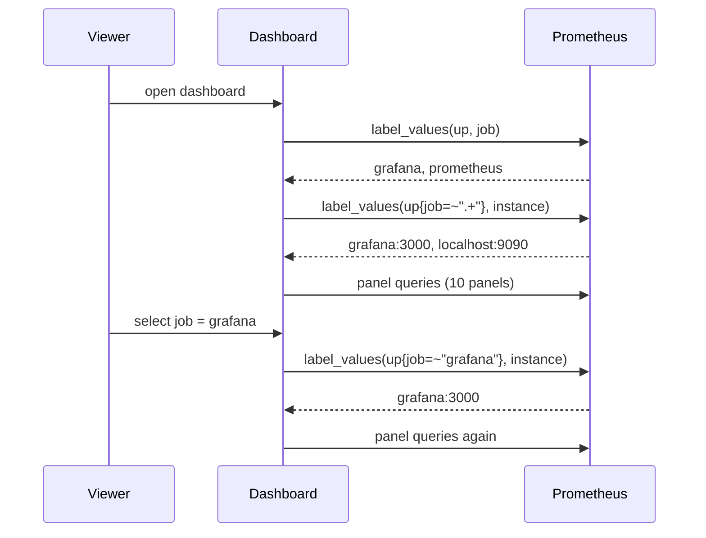

Every link in a chain is a round trip before any panel can load, and `refresh: 2` repeats the whole chain on every time-range change, including each auto-refresh tick when the range is relative. On a large Prometheus a careless `label_values(job)` (no metric) scans every series. Guidelines:

- Always restrict `label_values` with a metric that exists for every value you need (`up` is ideal for targets).
- Use `refresh: 1` for values that rarely change (clusters, environments).
- Keep chains to two or three levels. Deep chains make dashboards slow to open.

### 3.4 Repeating Panels and Rows

A panel with `"repeat": "<variable>"` is cloned once per selected value, and inside each clone `$variable` holds a single value.

```json
{
  "id": 12,
  "type": "timeseries",
  "title": "Request rate: $handler",
  "repeat": "handler",
  "repeatDirection": "h",
  "maxPerRow": 3,
  "gridPos": { "x": 0, "y": 37, "w": 8, "h": 6 },
  "targets": [
    {
      "refId": "A",
      "expr": "sum by (status_code) (rate(grafana_http_request_duration_seconds_count{job=\"grafana\", instance=~\"$instance\", handler=~\"$handler\"}[$__rate_interval]))",
      "legendFormat": "{{status_code}}"
    }
  ]
}
```

| Key | Effect |
| --- | --- |
| `repeat` | Variable to repeat over; it must be multi-value or have "All" |
| `repeatDirection: "h"` | Clones go side by side and wrap; `"v"` stacks them |
| `maxPerRow` | Horizontal limit before wrapping (2, 3, 4, 6, 8, 12 or 24) |

Rows repeat the same way (`"type": "row"` with `"repeat": "job"`), cloning every panel in the row. That is the classic way to build "one section per service".

Dynamic dashboards (Grafana 13, [M1](#m1-masterclass-dynamic-dashboards-and-the-v2-schema)) extend this: rows and tabs can repeat, an **auto grid** layout sizes repeated panels to the screen instead of a fixed `maxPerRow`, **conditional rendering** hides a section when a variable does not match or a panel has no data, and variables can be **scoped to a row or tab** instead of the whole dashboard.

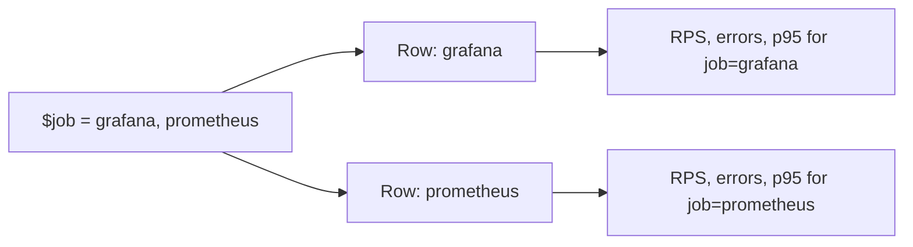

Repeats multiply queries: 3 panels × 20 jobs = 60 queries on open. Collapsed rows load their panels only when expanded, which makes "repeat collapsed rows" the scalable variant.

### 3.5 Dashboard Links, Data Links and URL State

All dashboard state lives in the URL, which is what makes drill-down links work:

```text
http://localhost:3000/d/learn-grafana-red/service-overview-red?from=now-6h&to=now&var-job=grafana&var-instance=grafana:3000&refresh=30s
```

| Parameter | Meaning |
| --- | --- |
| `from`, `to` | Relative (`now-6h`) or absolute (epoch ms or ISO) time range |
| `var-<name>` | Variable value; repeat it for multi-value (`var-job=a&var-job=b`) |
| `refresh` | Auto-refresh interval; cannot go below the server's `min_refresh_interval` (5 s by default) |
| `timezone` | `browser`, `utc` or an IANA zone |
| `viewPanel` | Open one panel full screen, such as `viewPanel=panel-5` |
| `kiosk` | Hide the navigation for wall displays |

**Dashboard links** sit in the dashboard header. The starter links to every dashboard tagged `sandbox`, keeping the time range:

```json
"links": [
  {
    "title": "Sandbox dashboards",
    "type": "dashboards",
    "tags": ["sandbox"],
    "asDropdown": true,
    "includeVars": false,
    "keepTime": true
  }
]
```

**Data links** sit on values. Clicking a series or table cell opens a URL built from that data point:

```json
"fieldConfig": {
  "defaults": {
    "links": [
      {
        "title": "Open ${__field.labels.instance} in the instance dashboard",
        "url": "/d/instance-detail/instance-detail?var-instance=${__field.labels.instance}&${__url_time_range}"
      },
      {
        "title": "Logs for this job",
        "url": "/explore?left=${__url_time_range}&schemaVersion=1",
        "targetBlank": true
      }
    ]
  }
}
```

| Data link variable | Value |
| --- | --- |
| `${__field.labels.<label>}` | Label of the series that was clicked |
| `${__field.name}`, `${__series.name}` | Field or series display name |
| `${__value.raw}`, `${__value.text}`, `${__value.time}` | The clicked value, raw or formatted, and its timestamp |
| `${__data.fields.<column>}` | Another column of the same table row |
| `${__url_time_range}` | Current time range as URL parameters |
| `${__all_variables}` | All dashboard variables as URL parameters |

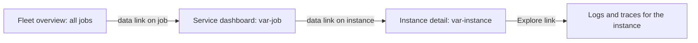

### 3.6 Annotations

Annotations mark events on time series panels. The starter uses two kinds:

```json
"annotations": {
  "list": [
    {
      "builtIn": 1,
      "datasource": { "type": "grafana", "uid": "-- Grafana --" },
      "enable": true,
      "hide": true,
      "name": "Annotations & Alerts",
      "type": "dashboard"
    },
    {
      "name": "Process restarts",
      "datasource": { "type": "prometheus", "uid": "${datasource}" },
      "enable": true,
      "iconColor": "orange",
      "expr": "changes(process_start_time_seconds{job=~\"$job\"}[2m]) > 0",
      "step": "1m",
      "titleFormat": "Process restarted",
      "textFormat": "{{job}} on {{instance}}"
    }
  ]
}
```

| Kind | Source | Good for |
| --- | --- | --- |
| Built-in | Annotations stored in Grafana's database, plus alert state changes | Manual notes, deploy markers posted by CI |
| Query (Prometheus) | Any expression; each step where it returns a value becomes an event | Restarts, config reloads, version changes |
| Query (Loki) | A LogQL log query; each line becomes an event | Deploy log lines, errors |
| Region | An annotation with `timeEnd` | Incidents, maintenance windows |

`changes(process_start_time_seconds[2m]) > 0` is a reliable restart detector: the start time is constant for the life of a process and changes exactly when it restarts. The window `[2m]` is deliberately fixed here, because it must be longer than the annotation `step` (1 m) and is not a rate.

Post a deploy marker from CI so every dashboard shows when the code changed:

```bash
curl -s -H "Authorization: Bearer $GRAFANA_TOKEN" -H 'Content-Type: application/json' \
  -X POST http://localhost:3000/api/annotations -d "{
    \"dashboardUID\": \"learn-grafana-red\",
    \"time\": $(date +%s000),
    \"tags\": [\"deploy\", \"checkout\"],
    \"text\": \"checkout v1.4.2 deployed by CI\"
  }"
```

Leave out `dashboardUID` to create an organization-wide annotation, then show it on any dashboard with a built-in annotation query filtered by tag `deploy`.

### 3.7 Library Panels, Templates and Reuse

A **library panel** is stored once and linked from many dashboards. Editing it updates every dashboard that uses it.

```json
{
  "id": 20,
  "gridPos": { "x": 0, "y": 40, "w": 12, "h": 8 },
  "libraryPanel": { "uid": "red-latency-p95", "name": "p95 latency by job" }
}
```

| Reuse tool | Shares | Best for | Watch out |
| --- | --- | --- | --- |
| Library panel | One panel definition | A KPI that must look identical everywhere | Every consuming dashboard must define the variables the panel uses; file provisioning cannot create library panels (use the API, Terraform or Git Sync) |
| Repeated panel or row | A panel template inside one dashboard | One section per service, region or handler | Query count grows with the selection |
| Dashboard template / suggested dashboards | A starting point copied into a new dashboard | Onboarding new services | A copy, not a link: later template fixes do not propagate |
| Cross-dashboard variables (13.3 public preview) | Variable definitions, globally or per folder | Consistent `$cluster` and `$env` everywhere | Behind the `grafana.dashboardGlobalVariables` feature toggle; preview features can change |
| Generated JSON (Jsonnet, Foundation SDK, Terraform) | Everything | Dozens of near-identical dashboards | Needs a build step; covered in Stage 6 |

### 3.8 Dashboard Design Methods

A dashboard answers a question for an audience. Pick the method by what you are watching:

| Method | Signals | For | Starter mapping |
| --- | --- | --- | --- |
| **RED** | Rate, Errors, Duration | Request-driven services (APIs, web servers, queues consumers) | The four stats and the two time series |
| **USE** | Utilization, Saturation, Errors | Resources (CPU, memory, disks, connection pools) | Resident memory, goroutines |
| **Four golden signals** | Latency, traffic, errors, saturation | User-facing services, SRE practice | RED plus a saturation panel |
| **SLO dashboard** | SLI, error budget remaining, burn rate | Service owners and incident commanders | Stage 5 |

Lay dashboards out as a **hierarchy**, each level linking to the next with the selection preserved:

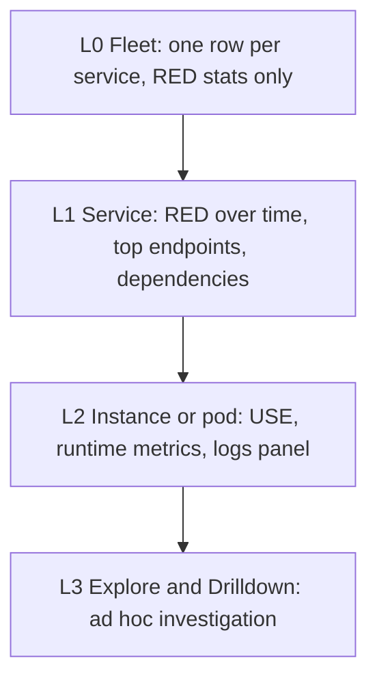

Layout rules that make a dashboard readable under stress:

1. **Top row: the verdict.** Four to six stat panels that say whether things are fine, with thresholds that match the alerts.
2. **Second band: trends.** The same signals over time, so "is it getting worse?" is answered at a glance.
3. **Below: breakdowns.** By job, endpoint, instance; tables and heatmaps.
4. **Collapsed rows for detail** nobody needs until they do.
5. **One unit and colour meaning per dashboard.** Red always means bad; requests are always req/s.
6. **Descriptions on every non-obvious panel.** The `description` field shows as an info icon; write what "bad" looks like.
7. **Fewer than about 25 panels.** Beyond that, split along the hierarchy.

### 3.9 Recording Rules Behind the Dashboards

The RED panels do not query raw metrics. They query **recording rules**, series Prometheus pre-computes every 15 s. Three reasons:

- **Speed**: a stat panel reading `job:http_requests:rate5m` touches a handful of series instead of every handler, method and status code.
- **Consistency**: Prometheus calls its counter `prometheus_http_requests_total` with label `code`; Grafana calls it `grafana_http_request_duration_seconds_count` with label `status_code`. The rules map both into one schema, so the panels never need to know which exporter produced the data.
- **Shared meaning**: alerts (Stage 5) can use the same series, so a red panel and a page agree.

```yaml
groups:
  - name: red-normalization
    interval: 15s
    rules:
      - record: job:http_requests:rate5m
        expr: |
          sum by (job) (rate(prometheus_http_requests_total[5m]))
            or
          sum by (job) (rate(grafana_http_request_duration_seconds_count[5m]))

      - record: job:http_errors:rate5m
        expr: |
          sum by (job) (rate(prometheus_http_requests_total{code=~"5.."}[5m]))
            or
          sum by (job) (rate(grafana_http_request_duration_seconds_count{status_code=~"5.."}[5m]))

      - record: job:http_errors:ratio_rate5m
        expr: |
          (job:http_errors:rate5m / job:http_requests:rate5m)
            or
          (job:http_requests:rate5m * 0)

      - record: job:http_request_duration_seconds:p95_5m
        expr: |
          histogram_quantile(0.95,
            sum by (job, le) (rate(prometheus_http_request_duration_seconds_bucket[5m]))
              or
            sum by (job, le) (rate(grafana_http_request_duration_seconds_bucket[5m]))
          )
```

| Line / API | Role | What happens at runtime |
| :--- | :--- | :--- |
| `job:http_requests:rate5m` | Name in `level:metric:operations` form | Readers know at a glance it is aggregated to `job`, from HTTP requests, as a 5-minute rate |
| `A or B` | Union of two sources | `or` keeps every series of A and adds series of B whose labels do not match any in A. The `job` labels differ, so both survive |
| One rule per name | Avoids duplicate rules | Two rules with the same name and labels fail `promtool check rules` with `duplicate rule(s) found`, because they would overwrite each other |
| Rule order in the group | Dependencies | Rules in a group run in sequence, so the ratio rule sees the two rate rules from the same evaluation |
| `or (job:http_requests:rate5m * 0)` | Zero instead of empty | A job that never returned a 5xx has no error series; without the fallback its error-ratio panel shows "No data" instead of 0% |
| `sum by (job, le)` inside `histogram_quantile` | Aggregate buckets before the quantile | Quantiles cannot be averaged; summing buckets and then taking the quantile is the only correct aggregation |

Rules are code, so the starter tests them with `promtool test rules`. The input series grow at known rates and the test asserts the outputs:

```yaml
rule_files:
  - ../rules/red.rules.yml

evaluation_interval: 15s
fuzzy_compare: true

tests:
  - interval: 15s
    input_series:
      - series: 'prometheus_http_requests_total{job="prometheus",instance="localhost:9090",handler="/api/v1/query",code="200"}'
        values: '0+30x60'
      - series: 'prometheus_http_requests_total{job="prometheus",instance="localhost:9090",handler="/api/v1/query",code="503"}'
        values: '0+7.5x60'
      - series: 'grafana_http_request_duration_seconds_count{job="grafana",instance="grafana:3000",handler="/api/ds/query",method="POST",status_code="200"}'
        values: '0+15x60'
    promql_expr_test:
      - expr: job:http_errors:ratio_rate5m
        eval_time: 10m
        exp_samples:
          - labels: 'job:http_errors:ratio_rate5m{job="prometheus"}'
            value: 0.2
          - labels: 'job:http_errors:ratio_rate5m{job="grafana"}'
            value: 0
```

`'0+30x60'` means "start at 0, add 30 every interval, 60 times": 30 per 15 s is 2 req/s. The 503 series adds 0.5 req/s, so the ratio is 0.5 ÷ 2.5 = 0.2, and Grafana's job, which has no 5xx series at all, must come out as 0 thanks to the fallback. The full file also tests the request rates and the p95 interpolation. `fuzzy_compare: true` accepts float noise such as `2.4999999999999996`; the p95 test rounds with `round(..., 0.001)` because interpolation noise is larger.

`examples/03-recording-rules/rules.sh` runs `promtool check config`, `promtool check rules` and `promtool test rules`, then checks a **contract**: every `level:metric:operation` series that any dashboard queries must be defined by a rule. A renamed rule therefore fails CI instead of silently emptying a panel.

### 3.10 Dashboards That Stay Fast and Correct

A dashboard's cost is roughly *panels × queries per panel × viewers ÷ refresh interval*. A 30-panel dashboard on a wall screen refreshing every 10 s sends 180 queries a minute from that screen alone.

| Lever | Setting | Effect |
| --- | --- | --- |
| Recording rules | Panels query pre-aggregated series | Biggest single win for expensive PromQL |
| Instant queries | `instant: true` for stats and tables | One evaluation instead of hundreds of steps |
| Refresh interval | `"refresh": "30s"` or longer; server `min_refresh_interval` | Fewer queries per viewer |
| Collapsed rows | `"collapsed": true` | Panels load only when expanded |
| Max data points | Lower for wide panels | Fewer points per query |
| Variable refresh | `refresh: 1` where possible | No variable queries on every refresh tick |
| Lazy loading | Built in | Panels below the fold load when scrolled into view |
| Query caching | Enterprise and Cloud feature | Repeated identical queries are served from cache |

Correctness is enforced the same way as code quality: by a linter. `examples/01-dashboard-lint/rules.jq` encodes the rules from Stages 1-3:

```jq
($panels[] | . as $p | .targets[]? | select((.expr // "") | test("\\b(rate|irate|increase)\\("))
  | select((.expr) | test("\\$__rate_interval") | not)
  | "panel \($p.id) query \(.refId): rate()/increase() should use [$__rate_interval], not a fixed window"),

($panels[] | select(.type == "timeseries" or .type == "stat" or .type == "gauge" or .type == "bargauge")
  | select((.fieldConfig.defaults.unit // "") == "")
  | "panel \(.id) \"\(.title)\" (\(.type)) has no unit")
```

| Rule | Why it exists |
| --- | --- |
| uid of 1-40 characters from `[a-zA-Z0-9_-]` | Stable URLs; Git Sync and the API key on it |
| `id` is null | Provisioned dashboards must not carry another database's id |
| `schemaVersion` at least 39 | Very old JSON is migrated on every load and diffs badly |
| Unique panel ids | Duplicates break repeats, links and `viewPanel` |
| `x + w` at most 24 | Keeps the grid predictable |
| Only provisioned data source uids or `${datasource}` | A uid from someone's laptop breaks on every other instance |
| `$__rate_interval` in rates | Correct at every zoom level |
| Units on numeric panels | No unitless numbers in front of on-call engineers |
| `${datasource}` requires a `datasource` variable | Otherwise the panels have no data source at all |

`lint.sh` also runs the rules against `fixtures/broken-dashboard.json` and asserts that each rule fires, so a regex typo in the linter cannot make it silently pass everything.

### 3.11 Pitfalls

| Pitfall | Symptom | Fix |
| --- | --- | --- |
| `job="$job"` with a multi-value variable | Panels empty when two values are selected, or when "All" is selected | Use `job=~"$job"` |
| `label_values(job)` without a metric on a big Prometheus | Dashboard takes seconds to open; Prometheus CPU spikes on every load | `label_values(up, job)` or another metric with matchers |
| Custom `allValue: ".+"` plus a variable regex that hides values | "All" shows data for values that are not in the drop-down | Remove `allValue` so "All" expands to the visible list |
| Variable defined after the variable that uses it, in an old dashboard | First load shows `$job` literally in queries | Grafana resolves dependencies, but re-save old dashboards in current Grafana; check for typos in names |
| Repeat on a variable without multi-value or All | Only one panel ever appears | Enable `multi` or `includeAll` |
| Repeated panels across 50 values | Dashboard opens slowly and Prometheus shows a burst of queries | Repeat collapsed rows, or move to a table with data links |
| Dashboard variable in an alert query | Alert rule is rejected or never matches | Alerts have no dashboard context; write the label value explicitly |
| Library panel using `$cluster` in a dashboard without `$cluster` | Panel shows no data or raw `$cluster` text | Define the variable in every consuming dashboard, or use cross-dashboard variables |
| Annotation query on a fine `step` over long ranges | Thousands of markers, slow rendering | Raise `step` and use `changes()` or `> 0` expressions that are sparse |
| Two recording rules with the same name and labels | `promtool check rules` fails with `duplicate rule(s) found` | One rule per name, union sources with `or` |
| Ratio rule without a fallback | "No data" on the error panel for healthy services | `(errors / total) or (total * 0)` |
| Renaming a recording rule | Panels quietly show "No data" | The contract check in `examples/03-recording-rules` |

### 3.12 Best Practices

- **Give every dashboard a `$datasource` variable**: the same JSON then works against staging, production and a long-term store.
- **Restrict every `label_values` with a metric and matchers**: variable queries run on every load.
- **Use `=~` for every variable matcher**: it works for one value, many values and "All".
- **Keep URLs as the unit of sharing**: links with `${__url_time_range}` and `var-` parameters let a colleague see exactly what you see.
- **Mark deploys and restarts with annotations**: most "what changed?" questions are answered by a vertical line.
- **Design top-down: verdict, trends, breakdowns**: on-call engineers read the top row first and may read nothing else.
- **Pre-compute with recording rules, and test them with `promtool`**: dashboards, alerts and SLOs then share one tested definition.
- **Lint dashboards in CI**: the cheapest review is the one a machine does on every pull request.

### 3.13 Hands-on Exercise

Add a **`$handler`** variable to the RED dashboard, chained to `$job` and `$instance`, and a time series panel that **repeats once per selected handler**.

Requirements:

1. Query variable over `label_values(grafana_http_request_duration_seconds_count{job=~"$job", instance=~"$instance"}, handler)`, multi-value with "All", refreshed on time-range change, filtered by the regex `/^\/api\/.*/` so only API handlers appear.
2. A time series panel titled `Request rate: $handler` that repeats horizontally, three per row, and stacks request rate by `status_code`.
3. The linter still passes.

Expected result: selecting three handlers shows three panels side by side, each titled with one handler path, each with one stacked area per status code (mostly `200`). The solution (the variable and the panel) is in [`solutions/stage-3/handler-variable.json`](solutions/stage-3/handler-variable.json): add `templating_list_addition` to `templating.list` and `repeated_panel` to `panels`.

[Back to top ⤴️](#-table-of-contents)

---

## 4. Stage 4: Logs, Traces & Profiles: Loki, Tempo, Pyroscope and Correlations

Metrics say that something is wrong; logs, traces and profiles say why. This stage adds the other signal types to the Prometheus foundation and wires them together so a click moves you from a latency spike to the trace that caused it and the log lines of that request. Prerequisites: Stages 1-3. Afterwards you can provision a correlated LGTM data source set and write the LogQL and TraceQL that incident work needs.

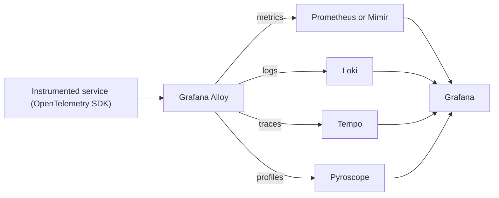

### 4.1 Loki and LogQL

Loki indexes only **labels** (a small set such as `service_name`, `namespace`, `level`), not the log text. A query first selects streams by label, then scans their content. That makes ingestion cheap and keeps the index small, at the price of making label design decisive.

| | Loki | Elasticsearch / OpenSearch |
| --- | --- | --- |
| Index | Labels only | Every field (inverted index) |
| Storage | Compressed chunks in object storage | Index plus documents on local disks |
| Fast queries | Narrow label selectors over a time range | Arbitrary full-text and field search |
| Cost driver | Bytes scanned per query | Index size and cluster nodes |
| Query language | LogQL (PromQL-like) | Query DSL, KQL, ES\|QL |

```logql
# Log query: streams for one service, lines containing "error", parsed as JSON, filtered on a field
{service_name="checkout"} |= "error" | json | status >= 500 | line_format "{{.method}} {{.path}} {{.status}}"

# Metric query: error lines per second by service, for a time series panel
sum by (service_name) (rate({service_name=~"checkout|payments"} | json | level="error" [$__auto]))
```

`$__auto` is the Loki counterpart of `$__rate_interval`: Grafana replaces it with a range that fits the panel's step. Keep label cardinality low: a label per user id or request id creates a stream per value and makes Loki slow and expensive. Put such values in the log line or in **structured metadata** (Loki 3) instead.

### 4.2 Tempo and TraceQL

Tempo stores traces by trace id in object storage and finds them with **TraceQL**, which selects spans by attributes, duration and status:

```traceql
{ resource.service.name = "checkout" && status = error && duration > 500ms }
```

```traceql
{ resource.service.name = "checkout" } | rate() by (span.http.route)
```

The second query is a TraceQL metrics query: it turns spans into a time series, useful when a service has traces but no metrics yet.

### 4.3 Correlations: Exemplars, Derived Fields and Trace-to-Logs

Correlation settings live in each data source's `jsonData`, so they can be provisioned:

```yaml
apiVersion: 1

datasources:
  - name: Prometheus
    type: prometheus
    uid: prometheus
    url: http://prometheus:9090
    jsonData:
      timeInterval: 15s
      exemplarTraceIdDestinations:
        - name: trace_id
          datasourceUid: tempo

  - name: Loki
    type: loki
    uid: loki
    url: http://loki:3100
    jsonData:
      derivedFields:
        - name: TraceID
          matcherRegex: 'trace_id=(\w+)'
          datasourceUid: tempo
          url: '$${__value.raw}'

  - name: Tempo
    type: tempo
    uid: tempo
    url: http://tempo:3200
    jsonData:
      tracesToLogsV2:
        datasourceUid: loki
        spanStartTimeShift: -5m
        spanEndTimeShift: 5m
        filterByTraceID: true
        tags:
          - key: service.name
            value: service_name
      serviceMap:
        datasourceUid: prometheus
      nodeGraph:
        enabled: true
```

| Setting | Click path it enables |
| --- | --- |
| `exemplarTraceIdDestinations` | A dot on a latency graph (an exemplar) opens its trace in Tempo |
| `derivedFields` | A `trace_id=...` in a log line becomes a link to the trace |
| `tracesToLogsV2` | A span opens the logs of the same service around the span's time |
| `serviceMap` | Tempo draws a service graph from span metrics stored in Prometheus |

`$${__value.raw}` doubles the `$` because provisioning files expand environment variables; a single `$` would be replaced at startup.

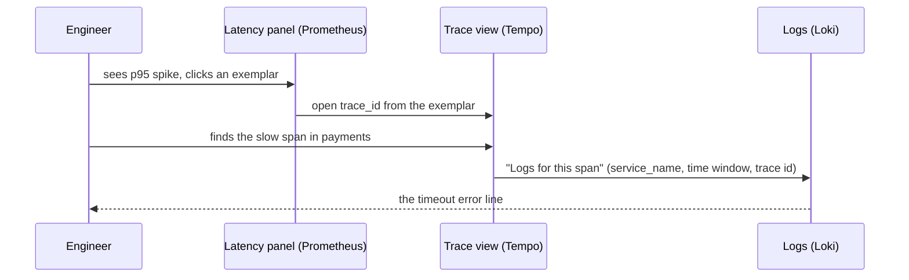

### 4.4 Grafana Alloy

Alloy is Grafana's OpenTelemetry-compatible collector and the replacement for Grafana Agent (end of life in November 2025) and for Promtail (deprecated in favour of Alloy). Its configuration language wires components into pipelines:

```alloy
otelcol.receiver.otlp "default" {
  grpc { endpoint = "0.0.0.0:4317" }
  http { endpoint = "0.0.0.0:4318" }
  output {
    metrics = [otelcol.exporter.prometheus.default.input]
    logs    = [otelcol.exporter.loki.default.input]
    traces  = [otelcol.exporter.otlp.tempo.input]
  }
}

otelcol.exporter.prometheus "default" {
  forward_to = [prometheus.remote_write.mimir.receiver]
}

prometheus.remote_write "mimir" {
  endpoint { url = "http://mimir:9009/api/v1/push" }
}

otelcol.exporter.loki "default" {
  forward_to = [loki.write.default.receiver]
}

loki.write "default" {
  endpoint { url = "http://loki:3100/loki/api/v1/push" }
}

otelcol.exporter.otlp "tempo" {
  client {
    endpoint = "tempo:4317"
    tls { insecure = true }
  }
}
```

### 4.5 Pitfalls

| Pitfall | Symptom | Fix |
| --- | --- | --- |
| High-cardinality Loki labels (user id, request id) | Ingestion errors about too many streams; slow queries | Keep ids in the line or in structured metadata |
| Wide Loki query without a selective label | Queries time out or hit the bytes-scanned limit | Add `service_name`, `namespace` or another label first, then filter |
| Single `$` in a provisioned derived field URL | The link is empty, because `${__value.raw}` was expanded at startup | Write `$${__value.raw}` in provisioning YAML |
| Trace-to-logs tag names differ between OTel and Loki | "Logs for this span" returns nothing | Map `service.name` to the Loki label `service_name` in `tags` |

### 4.6 Best Practices

- **Use the same service name everywhere**: correlations rely on one identifier across metrics, logs and traces.
- **Collect with one agent (Alloy)**: one pipeline to configure, upgrade and monitor.
- **Provision correlations with the data sources**: a click path that exists only in someone's UI edits is lost on the next rebuild.

[Back to top ⤴️](#-table-of-contents)

---

## 5. Stage 5: Grafana Alerting & SLOs

Grafana Alerting evaluates rules on the server, on the same query and expression engine panels use, and routes notifications through an embedded Alertmanager. This stage covers rules, notification policies and SLO burn-rate alerts, all provisioned from files. Prerequisites: Stages 2-3 (expressions and recording rules). Afterwards you can define pages that fire on user impact and stay quiet otherwise.

```mermaid
flowchart LR
    Rule["Alert rule: queries + expressions + condition"] --> Eval["Evaluation every group interval"]
    Eval --> State["Alert instances, one per label set"]
    State --> Policy["Notification policy tree (label matchers)"]
    Policy --> Group["Grouping, group_wait, repeat_interval"]
    Group --> CP["Contact point: Slack, PagerDuty, email, webhook"]
    Silence["Silences and mute timings"] -.-> Group
```

### 5.1 Rule Evaluation and Alert States

```mermaid
stateDiagram-v2
    [*] --> Normal
    Normal --> Pending: condition true
    Pending --> Normal: condition false before "for" elapsed
    Pending --> Alerting: condition true for the whole "for" duration
    Alerting --> Recovering: condition false
    Recovering --> Alerting: condition true again within "keep firing for"
    Recovering --> Normal: stays false
    Normal --> NoData: query returns nothing
    Normal --> Error: query fails
```

Each rule produces one **alert instance per label set** its condition returns, so `sum by (job)` yields one instance per job and the notification names the job that broke.

### 5.2 Provisioning an Alert Rule

```yaml
apiVersion: 1

groups:
  - orgId: 1
    name: red-slo
    folder: platform
    interval: 1m
    rules:
      - uid: red-error-ratio-high
        title: Error ratio above 5%
        condition: C
        for: 5m
        noDataState: OK
        execErrState: Error
        labels:
          severity: page
          team: platform
        annotations:
          summary: '{{ $labels.job }} returns {{ humanizePercentage $values.A.Value }} errors'
          runbook_url: https://github.com/TheLearningHubOrg/learn-grafana#5-stage-5-grafana-alerting--slos
        data:
          - refId: A
            relativeTimeRange: { from: 600, to: 0 }
            datasourceUid: prometheus
            model:
              refId: A
              expr: job:http_errors:ratio_rate5m
              instant: true
          - refId: C
            datasourceUid: __expr__
            model:
              refId: C
              type: threshold
              expression: A
              conditions:
                - evaluator: { type: gt, params: [0.05] }
```

The rule reads the same recording rule as the starter's error-ratio panel, with the same 5% threshold, so the panel turns red exactly when the alert starts pending.

### 5.3 SLO Burn-rate Alerts

An SLO of 99.9% over 30 days allows 0.1% errors: the **error budget**. The burn rate is how fast you spend it: burn rate 1 spends the budget in exactly 30 days, burn rate 14.4 spends 2% of it in one hour. Multi-window alerts require both a long and a short window to agree, which catches real incidents quickly and resets fast after recovery:

| Severity | Long window | Short window | Burn rate | Budget spent when it fires |
| --- | --- | --- | --- | --- |
| Page | 1h | 5m | 14.4 | 2% |
| Page | 6h | 30m | 6 | 5% |
| Ticket | 3d | 6h | 1 | 10% |

```promql
(
  sum(rate(http_requests_total{job="checkout", code=~"5.."}[1h])) / sum(rate(http_requests_total{job="checkout"}[1h])) > (14.4 * 0.001)
)
and
(
  sum(rate(http_requests_total{job="checkout", code=~"5.."}[5m])) / sum(rate(http_requests_total{job="checkout"}[5m])) > (14.4 * 0.001)
)
```

### 5.4 Pitfalls

| Pitfall | Symptom | Fix |
| --- | --- | --- |
| Dashboard variables in alert queries | Rule cannot be saved or never matches | Write label values explicitly; alerts have no dashboard context |
| `noDataState: Alerting` on sparse series | Pages for "no data" every quiet night | Use `OK` or `NoData` and alert on absence explicitly with `absent()` |
| Thresholds that differ from the panels | The dashboard is green while people get paged | Read the same recording rule in both, with the same threshold |
| Grouping on too few labels | One notification hides fifty different failures | Group by `alertname` plus the labels that identify the owner |

### 5.5 Best Practices

- **Page on symptoms (SLO burn), ticket on causes**: users feel errors and latency, not CPU.
- **Put a `runbook_url` on every paging rule**: the responder starts from instructions, not from a blank screen.
- **Provision rules, contact points and policies from files or Terraform**: alerting changes then go through review like code.

[Back to top ⤴️](#-table-of-contents)

---

## 6. Stage 6: Observability as Code, Security & Operating Grafana at Scale

One Grafana for a whole company is a platform: hundreds of dashboards, many teams, SSO, and an availability target of its own. This stage covers the tools that keep it reviewable and the architecture that keeps it up. Prerequisites: Stages 1-5. Afterwards you can choose an as-code workflow and run Grafana highly available.

```mermaid
flowchart TB
    LB["Load balancer"] --> G1["Grafana replica 1"]
    LB --> G2["Grafana replica 2"]
    LB --> G3["Grafana replica 3"]
    G1 --> DB[("PostgreSQL or MySQL")]
    G2 --> DB
    G3 --> DB
    G1 <-->|"alerting HA gossip"| G2
    G2 <-->|"alerting HA gossip"| G3
    G1 --> R["Image renderer service"]
    G1 --> Cache["Remote cache (Redis)"]
```

### 6.1 Choosing an Observability-as-Code Tool

| Tool | Language | Direction | Best for |
| --- | --- | --- | --- |
| File provisioning (Stage 1) | YAML + JSON | Files to Grafana | Immutable images, CI tests |
| Terraform provider `grafana/grafana` | HCL | Plan and apply | Organizations already on Terraform; data sources, folders, teams, alerting |
| Foundation SDK | Go, TypeScript, Python, Java, PHP | Generates JSON | Many similar dashboards built from code with types |
| Jsonnet with Grafonnet | Jsonnet | Generates JSON | Existing Jsonnet monitoring mixins |
| `grafanactl` CLI | YAML / JSON resources | Push and pull | Scripting against the `/apis` resource API |
| Git Sync (M2) | JSON in Git | Both ways | Teams that edit in the UI and review in Git |

```mermaid
flowchart TD
    Q1{"Do people edit dashboards in the UI?"} -->|yes| GS["Git Sync"]
    Q1 -->|no| Q2{"Many near-identical dashboards?"}
    Q2 -->|yes| SDK["Foundation SDK or Jsonnet, output committed or provisioned"]
    Q2 -->|no| Q3{"Already managing infra with Terraform?"}
    Q3 -->|yes| TF["Terraform provider"]
    Q3 -->|no| FP["File provisioning"]
```

```hcl
terraform {
  required_providers {
    grafana = {
      source  = "grafana/grafana"
      version = ">= 3.0"
    }
  }
}

provider "grafana" {
  url  = "http://localhost:3000"
  auth = var.grafana_token
}

variable "grafana_token" {
  type      = string
  sensitive = true
}

resource "grafana_folder" "platform" {
  title = "platform"
  uid   = "platform"
}

resource "grafana_dashboard" "red" {
  folder      = grafana_folder.platform.uid
  config_json = file("${path.module}/../grafana/dashboards/platform/service-overview.json")
  overwrite   = true
}
```

### 6.2 Security Model

| Control | Setting | Why |
| --- | --- | --- |
| Single sign-on | `[auth.generic_oauth]`, `[auth.azuread]`, `[auth.okta]`, `[auth.google]`, `[auth.github]`, SAML (Enterprise) | No local passwords to rotate or leak |
| Role mapping | `role_attribute_path` (JMESPath on the ID token) | Groups in the identity provider decide Viewer, Editor or Admin |
| Disable the login form | `[auth] disable_login_form = true` | Everyone goes through SSO |
| Service accounts | Tokens with `secondsToLive` | Automation identities that expire |
| Folder permissions for teams | Teams with Edit on their folders only | Least privilege without custom roles |
| Data source permissions | Enterprise and Cloud | Restrict who can query sensitive backends |
| Cookie security | `[security] cookie_secure = true`, `cookie_samesite = lax` behind HTTPS | Session cookies only over TLS |
| Content Security Policy | `[security] content_security_policy = true` | Limits script sources in the browser |

### 6.3 High Availability

For two or more replicas: point every replica at the same MySQL or PostgreSQL (`[database]`), let them gossip alerting state so each notification is sent once (`[unified_alerting] ha_peers` or `ha_redis_address`), run the image renderer as its own service, and put a load balancer in front. Sessions live in the database, so sticky sessions are not required.

### 6.4 Pitfalls

| Pitfall | Symptom | Fix |
| --- | --- | --- |
| Several replicas on SQLite | `database is locked` errors, lost saves | External MySQL or PostgreSQL |
| Alerting HA not configured | Every replica sends the same notification | Configure `ha_peers` or Redis for alerting HA |
| Terraform and UI editing the same dashboard | Drift on every plan; changes overwritten | One owner per resource: Terraform or Git Sync or the UI |

### 6.5 Best Practices

- **One source of truth per resource**: mixing tools on the same object guarantees drift.
- **Back up the database before every upgrade**: 13.0's storage migration cannot be undone without it.
- **Monitor Grafana itself**: request latency, data source errors and alerting evaluation duration are on its `/metrics`.

[Back to top ⤴️](#-table-of-contents)

---

## M1. Masterclass: Dynamic Dashboards and the v2 Schema

Dynamic dashboards (GA in Grafana 13) replace the single flat grid with composable layouts. The new model is stored in the v2 schema of the `dashboard.grafana.app` API group.

### M1.1 How It Works Internally

Grafana keeps one stored resource per dashboard and converts between API versions on read. That is why the starter's classic JSON can be fetched as v2 without editing anything.

```mermaid
flowchart LR
    File["Classic JSON file (schemaVersion 41)"] --> Prov["File provisioning"]
    Prov --> Store["Unified storage resource"]
    Store -->|"GET .../v1/..."| V1["v1: classic spec"]
    Store -->|"GET .../v2/..."| V2["v2: elements + layout + variables"]
    V2 --> Scenes["Scenes runtime in the browser"]
```

In v2, panels live in an `elements` map keyed by name, placement lives in `layout`, queries are typed `DataQuery` objects inside a `QueryGroup`, and the visualization is a `VizConfig`. The starter's first stat panel, as Grafana 13.3 returns it from the v2 endpoint:

```json
{
  "kind": "Panel",
  "spec": {
    "id": 1,
    "title": "Targets down",
    "data": {
      "kind": "QueryGroup",
      "spec": {
        "queries": [
          {
            "kind": "PanelQuery",
            "spec": {
              "refId": "A",
              "query": {
                "kind": "DataQuery",
                "group": "prometheus",
                "datasource": { "name": "${datasource}" },
                "spec": { "expr": "count(up{job=~\"$job\", instance=~\"$instance\"} == 0) or vector(0)", "instant": true }
              }
            }
          }
        ],
        "transformations": []
      }
    },
    "vizConfig": { "kind": "VizConfig", "group": "stat", "spec": { "fieldConfig": { "defaults": { "unit": "none" } } } }
  }
}
```

(trimmed). Fetch the full document with `GET /apis/dashboard.grafana.app/v2/namespaces/default/dashboards/learn-grafana-red`.

### M1.2 Production Checklist

- Decide per team whether new dashboards are authored in v2 or classic JSON, and lint the format you store.
- Pin tooling (linters, generators) to the schema version you store, and re-export after upgrades.
- Keep `uid`s stable when converting: links, alerts and Git Sync key on them.

[Back to top ⤴️](#-table-of-contents)

---

## M2. Masterclass: Git Sync and GitOps for Grafana

Git Sync (GA in 13.0) stores dashboards and folders as files in a Git repository and keeps Grafana and the repository in step in both directions.

### M2.1 How It Works Internally

```mermaid
sequenceDiagram
    participant U as Editor in Grafana
    participant G as Grafana (provisioning.grafana.app)
    participant R as Git repository
    participant CI as CI checks
    U->>G: save dashboard
    G->>R: commit to a branch, open pull request
    R->>CI: run dashboard lint
    CI-->>R: checks pass
    R->>R: merge to main
    R->>G: webhook (or polling)
    G->>G: pull and apply the change
```

| | File provisioning | Git Sync |
| --- | --- | --- |
| Who can change a dashboard | Whoever can merge to the repo | UI editors, through commits or pull requests |
| Feedback loop | Edit JSON, rebuild or wait for rescan | Save in the UI, review the diff |
| Failure mode | Startup error on bad JSON | Sync error shown on the repository page |

### M2.2 Production Checklist

- Run the same lint (`examples/01-dashboard-lint`) on pull requests that Git Sync opens.
- Back up the database before enabling Git Sync on an instance with existing dashboards, and stay on 13.0.1 or later.
- Use a token with access to one repository only.

[Back to top ⤴️](#-table-of-contents)

---

## M3. Masterclass: Alerting Internals and High Availability

### M3.1 How It Works Internally

```mermaid
flowchart TB
    Sched["Scheduler: ticks every evaluation interval"] --> Eval["Evaluator: queries + expressions"]
    Eval --> SM["State manager: one state per alert instance"]
    SM --> Sender["Sender"]
    Sender --> AM["Embedded Alertmanager: grouping, inhibition, silences"]
    AM --> CP["Contact points"]
    AM <-->|"notification log and silences gossip"| Peer["Alertmanager on other replicas"]
```

Every replica evaluates every rule; the Alertmanagers gossip their notification log so only one replica sends each notification.

### M3.2 Production Checklist

- Configure alerting HA (`ha_peers` or Redis) before running a second replica.
- Alert on Grafana's own evaluation failures and notification errors from its `/metrics`.
- Keep evaluation intervals at 1 m or longer for rules over recording rules; faster intervals mostly add load.

[Back to top ⤴️](#-table-of-contents)

---

## M4. Masterclass: Plugin Development with TypeScript and Go

Grafana plugins have a TypeScript and React frontend and, for data sources that query servers or support alerting, a Go backend built on the Grafana plugin SDK. Grafana 13 moved the frontend to React 19.

### M4.1 How It Works Internally

```mermaid
flowchart LR
    UI["Query editor (React, TypeScript)"] --> API["/api/ds/query"]
    API --> PM["Plugin manager"]
    PM -->|gRPC| BE["Backend plugin process (Go, grafana-plugin-sdk-go)"]
    BE --> Ext["External API"]
    BE -->|data frames| PM
```

```bash
npx @grafana/create-plugin@latest   # scaffolds frontend, Go backend, provisioning and a docker compose dev stack
```

### M4.2 Production Checklist

- Sign the plugin, or allow it explicitly with `allow_loading_unsigned_plugins` only in development.
- Implement health checks and alerting support in the backend, not the frontend.
- Test against the oldest and newest Grafana versions you declare in `plugin.json`.

[Back to top ⤴️](#-table-of-contents)

---

## M5. Masterclass: Flagship Blueprint: an LGTM Observability Platform

The blueprint combines every stage: Alloy collecting OpenTelemetry signals, Mimir, Loki, Tempo and Pyroscope as backends, a highly available Grafana on PostgreSQL, dashboards and alert rules from Git, and SLO burn-rate alerts.

### M5.1 Architecture

```mermaid
flowchart TB
    subgraph Apps["Services"]
        S1["checkout"]
        S2["payments"]
    end
    S1 --> A["Alloy"]
    S2 --> A
    A --> Mi["Mimir"]
    A --> Lo["Loki"]
    A --> Te["Tempo"]
    A --> Py["Pyroscope"]
    subgraph GrafanaHA["Grafana HA"]
        G1["replica 1"]
        G2["replica 2"]
    end
    Mi --> GrafanaHA
    Lo --> GrafanaHA
    Te --> GrafanaHA
    Py --> GrafanaHA
    GrafanaHA --> PG[("PostgreSQL")]
    Git["Git: dashboards, rules, provisioning"] --> GrafanaHA
```

### M5.2 Production Checklist

- Every signal carries the same `service.name`.
- Dashboards, alert rules, contact points and data sources come from Git; the UI is for exploration.
- Grafana runs at least two replicas with alerting HA, on a backed-up external database.

[Back to top ⤴️](#-table-of-contents)

---

## 7. Stage 7: Staff Grafana Observability Engineer Interview Handbook & Cheatsheet

### 7.1 Core Concepts (Q1-Q10)

#### Q1. What does Grafana store, and what does it not store?

Grafana stores configuration and collaboration state: dashboards and their versions, folders, users, teams, permissions, data source definitions (with encrypted secrets), alert rules and their state, silences, annotations and preferences. It stores no telemetry. Every panel and alert rule queries its data source at view or evaluation time. The practical consequences are that retention, query speed and cardinality limits are properties of the backends, that Grafana can be rebuilt from its database plus its provisioning files, and that losing the database loses only configuration, which is why provisioning from Git matters.

#### Q2. What are the main architectural trade-offs of putting Grafana in front of several backends?

The benefit is one interface, one permission model and one alerting engine for every signal type, and the freedom to change a backend without retraining every user. The cost is that Grafana becomes a shared dependency: an outage of Grafana or its database takes away the view of every system at once, and a slow backend shows up as "Grafana is slow". The query layer also adds a hop and a data frame conversion to every request.

Staff-level answers mention the mitigations: run Grafana highly available on an external database, keep provisioning in Git so an instance can be rebuilt in minutes, monitor Grafana's own query latency per data source to tell backend slowness from Grafana slowness, and keep the backends' own UIs (Prometheus, Alertmanager) reachable as a break-glass path.

#### Q3. How does a panel query travel from the browser to Prometheus?

The browser loads the dashboard JSON, interpolates variables, computes `$__interval` from the time range and panel width, and posts the panel's queries to `/api/ds/query`. The server authenticates the user, resolves each query's data source by uid, checks the `datasources:query` permission and calls the data source plugin, which adds stored credentials and calls Prometheus' `query_range` with the interval as step. The plugin converts the result into data frames and returns them; the browser then applies transformations, field config and the visualization. Section [1.3](#13-how-a-panel-query-travels) shows the sequence and a `curl` that replays the request.

#### Q4. What is `$__rate_interval`, and why is `rate(x[1m])` wrong on a dashboard?

`$__rate_interval` is max(`$__interval` + scrape interval, 4 × scrape interval). On long ranges the step grows to minutes, and a fixed `[1m]` window then evaluates only a fraction of the samples between steps, so spikes disappear and totals stop adding up. `$__rate_interval` always covers the full step plus one scrape and always includes at least four samples, which is the minimum for a stable rate. It depends on the data source's `timeInterval` matching the real scrape interval.

#### Q5. Why provision data sources with fixed uids?

Dashboards and alert rules reference data sources by uid. Without a fixed uid, every instance generates its own random one, so a dashboard exported from staging points at a data source that does not exist in production. Fixed uids make dashboard JSON portable between instances, make Terraform and Git Sync deterministic, and since Grafana 12 they must match `[a-zA-Z0-9_-]` with at most 40 characters or provisioning fails.

### 7.2 Staff Cheatsheet

| Need | Grafana answer | Gotcha |
| --- | --- | --- |
| Rate on a dashboard | `rate(x[$__rate_interval])` | Requires the data source `timeInterval` to match the scrape interval |
| Multi-value variable in PromQL | `label=~"$var"` | `=` breaks with two values or "All" |
| Portable data source reference | `"uid": "${datasource}"` plus a data source variable | Exported "for sharing" JSON uses `${DS_...}` inputs instead |
| One number from a series | Stat with `lastNotNull` | `mean` of a ratio is not the ratio over the range |
| Ratio per group | Group by, then calculate field | The reverse order sums ratios |
| Same maths in panel and alert | Server-side expressions | Transformations do not run in alerting |
| Block UI edits on provisioned dashboards | `allowUiUpdates: false` | Users see `Cannot save provisioned dashboard` |
| Secrets in provisioning | `secureJsonData` with `${ENV}` | `jsonData` is stored in plain text |
| Health check | `GET /api/health` | Reports database status, not data source status |
| New-style API | `/apis/dashboard.grafana.app/v1/namespaces/default/dashboards/<uid>` | `default` is org 1; other orgs use `org-<id>` |

[Back to top ⤴️](#-table-of-contents)

---

## 🧪 Example Projects

| Project | Builds on | What you practise | Stretch goal |
| --- | --- | --- | --- |
| [Starter: provisioned Grafana + Prometheus](./compose.yaml) (in this repo) | [Stage 1](#1-stage-1-foundations-architecture-installation--provisioning) to [Stage 3](#3-stage-3-variables-templating--dashboard-design) | Provisioning, RED dashboard, recording rules, dashboard lint, promtool tests | Add Alertmanager and an alert rule on the error-ratio rule |
| Node exporter USE dashboard | [2.4](#24-choosing-a-visualization), [3.8](#38-dashboard-design-methods) | USE method, units, thresholds, repeat rows per host | Library panels shared with a Kubernetes node dashboard |
| Service catalogue with drill-down | [3.5](#35-dashboard-links-data-links-and-url-state) | L0/L1/L2 hierarchy with data links that keep variables | Generate one L1 dashboard per service with the Foundation SDK |
| Deploy annotations from CI | [3.6](#36-annotations) | Annotations API, service account tokens | Region annotations spanning canary start to full rollout |
| Business KPIs from PostgreSQL | [2.8](#28-tables-and-transformations), [2.9](#29-server-side-expressions-and-sql-expressions) | SQL data source, macros, SQL expressions joining Prometheus | Alert when orders per minute drop below the weekly baseline |
| Logs and traces correlation lab | [Stage 4](#4-stage-4-logs-traces--profiles-loki-tempo-pyroscope-and-correlations) | Loki, Tempo, exemplars, trace-to-logs | Pyroscope profiles linked from slow spans |
| SLO burn-rate alerting | [Stage 5](#5-stage-5-grafana-alerting--slos) | Multi-window burn rates, notification policies | Error budget dashboard with remaining budget per service |
| Grafana as code with Terraform | [Stage 6](#6-stage-6-observability-as-code-security--operating-grafana-at-scale) | Folders, data sources and dashboards from HCL | Move one folder to Git Sync and compare workflows |

## 📝 Cheat Sheets

### CLI / Commands

```bash
# Run and inspect
docker compose up --build -d                    # start the starter stack
docker compose logs -f grafana                  # follow Grafana logs
curl -s localhost:3000/api/health               # database status and version
bash examples/run-all.sh                        # lint dashboards, check provisioning, test rules (needs jq, yq, promtool)
docker build --target validate .                # same checks without local tools

# grafana binary (inside the container)
grafana server --homepath /usr/share/grafana    # start the server
grafana cli plugins ls                          # installed plugins
grafana cli plugins install grafana-clock-panel # install a plugin (then restart)
grafana cli plugins update-all                  # update every plugin
grafana cli admin reset-admin-password 'new'    # reset the admin password

# HTTP API (export GRAFANA_TOKEN first)
H="Authorization: Bearer $GRAFANA_TOKEN"
curl -s -H "$H" 'localhost:3000/api/search?type=dash-db&query=RED'
curl -s -H "$H" localhost:3000/api/dashboards/uid/learn-grafana-red | jq '.dashboard' > red.json
curl -s -H "$H" localhost:3000/api/datasources/uid/prometheus
curl -s -H "$H" localhost:3000/apis | jq -r '.groups[].name'
curl -s -H "$H" localhost:3000/apis/dashboard.grafana.app/v2/namespaces/default/dashboards/learn-grafana-red

# Prometheus rules
promtool check config prometheus/prometheus.yml
promtool check rules prometheus/rules/*.yml
promtool test rules prometheus/tests/red.rules.test.yml
curl -X POST localhost:9090/-/reload            # reload rules (needs --web.enable-lifecycle)
```

### Dashboard JSON Quick Reference

| Task | Code |
| --- | --- |
| Data source from a variable | `"datasource": { "type": "prometheus", "uid": "${datasource}" }` |
| Instant table query | `{ "expr": "up", "instant": true, "range": false, "format": "table" }` |
| Legend from labels | `"legendFormat": "{{job}} / {{instance}}"` |
| Unit and minimum | `"fieldConfig": { "defaults": { "unit": "reqps", "min": 0 } }` |
| Thresholds | `"thresholds": { "mode": "absolute", "steps": [{ "color": "green", "value": null }, { "color": "red", "value": 1 }] }` |
| Override by regex | `{ "matcher": { "id": "byRegexp", "options": "/canary/" }, "properties": [...] }` |
| Value mapping | `{ "type": "value", "options": { "0": { "text": "DOWN", "color": "red" } } }` |
| Repeat a panel | `"repeat": "handler", "repeatDirection": "h", "maxPerRow": 3` |
| Chained variable | `"query": "label_values(up{job=~\"$job\"}, instance)"` |
| Math expression | `{ "refId": "B", "datasource": { "type": "__expr__", "uid": "__expr__" }, "type": "math", "expression": "$A * 60" }` |

## 📚 Resources

- [Grafana documentation](https://grafana.com/docs/grafana/latest/)
- [What's new in Grafana](https://grafana.com/docs/grafana/latest/whatsnew/)
- [Grafana upgrade guides](https://grafana.com/docs/grafana/latest/upgrade-guide/)
- [Provisioning reference](https://grafana.com/docs/grafana/latest/administration/provisioning/)
- [Dashboard JSON model](https://grafana.com/docs/grafana/latest/visualizations/dashboards/build-dashboards/view-dashboard-json-model/)
- [Variables](https://grafana.com/docs/grafana/latest/visualizations/dashboards/variables/)
- [Grafana HTTP API](https://grafana.com/docs/grafana/latest/developer-resources/api-reference/http-api/)
- [Grafana source repository and changelog](https://github.com/grafana/grafana)
- [Grafana blog](https://grafana.com/blog/)
- [Prometheus querying basics](https://prometheus.io/docs/prometheus/latest/querying/basics/)
- [Prometheus recording rules](https://prometheus.io/docs/prometheus/latest/configuration/recording_rules/)
- [Unit testing rules with promtool](https://prometheus.io/docs/prometheus/latest/configuration/unit_testing_rules/)

## 🤝 Contributing

Contributions are welcome. Read the [contributing guide](https://github.com/TheLearningHubOrg/.github/blob/main/CONTRIBUTING.md) and the [code of conduct](https://github.com/TheLearningHubOrg/.github/blob/main/CODE_OF_CONDUCT.md) before you open a pull request. Commit messages follow [Conventional Commits](https://www.conventionalcommits.org/), which drive the automated changelog.

## 📄 License

This project is licensed under the MIT License. See the [LICENSE](LICENSE) file for details.

## 🙏 Acknowledgments

- [Grafana](https://grafana.com/grafana/) and its maintainers
- [Prometheus](https://prometheus.io/) and `promtool`, which the starter uses for metrics and rule tests
- [jq](https://jqlang.org/), [yq](https://github.com/mikefarah/yq) and [ShellCheck](https://www.shellcheck.net/), which power the example checks

## 🌐 Connect with me

- [Twitter](https://twitter.com/manthan_ank)
- [LinkedIn](https://www.linkedin.com/in/manthanank)
- [Facebook](https://www.facebook.com/manthanank/)
- [Instagram](https://www.instagram.com/manthan_ank/)
- [YouTube](https://www.youtube.com/@manthanank)
- [GitHub](https://github.com/manthanank)

## ☕ Support

If you like this learning repository and find it useful, consider buying me a coffee or sponsoring me through GitHub Sponsors. Your support helps me keep these guides up to date. Thank you!

[](https://www.buymeacoffee.com/manthanank)

[](https://github.com/sponsors/manthanank)

---

Show your support by 🌟 the repository.
